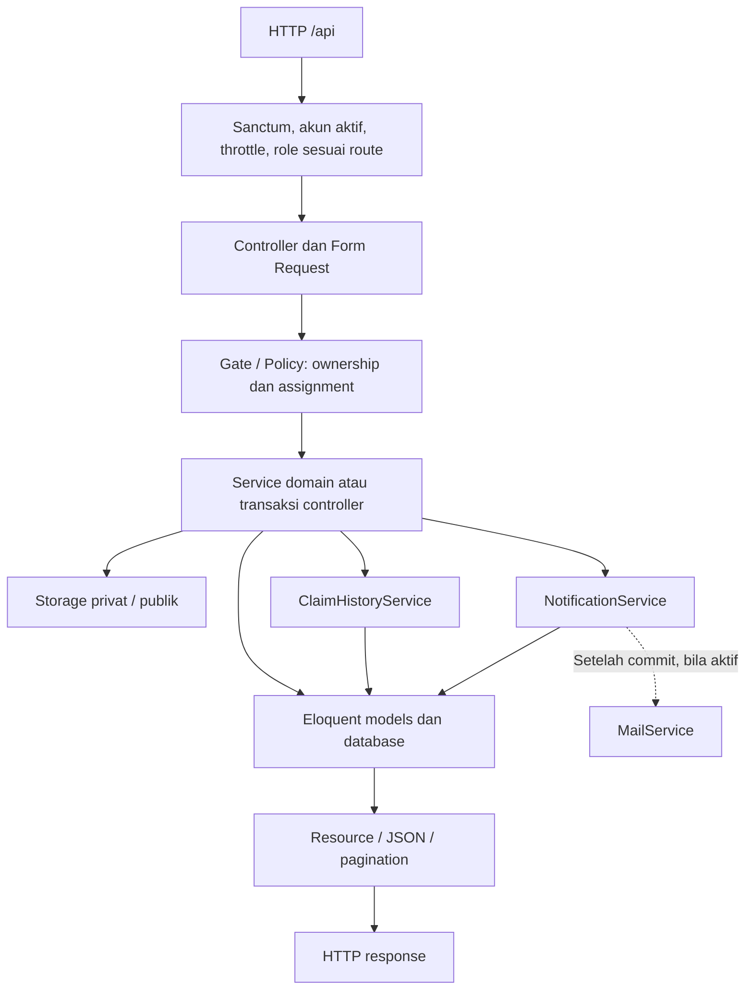
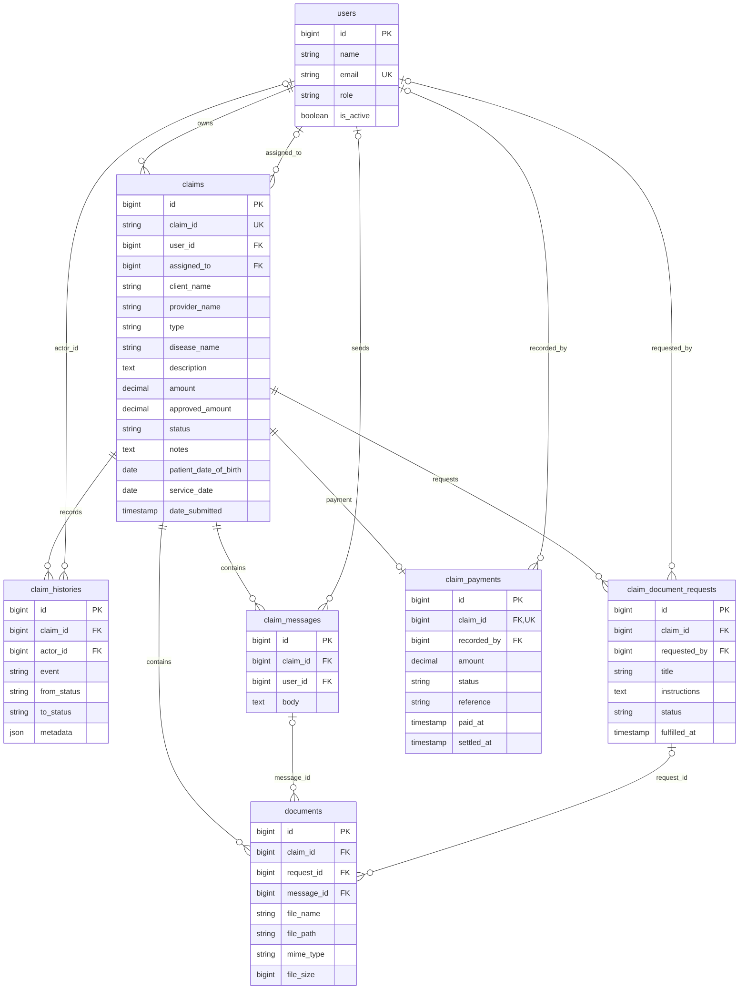
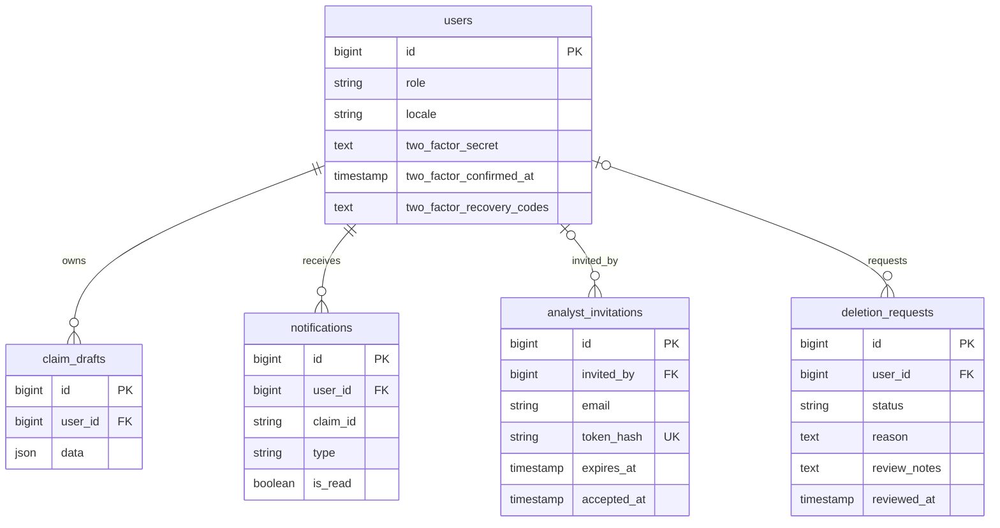
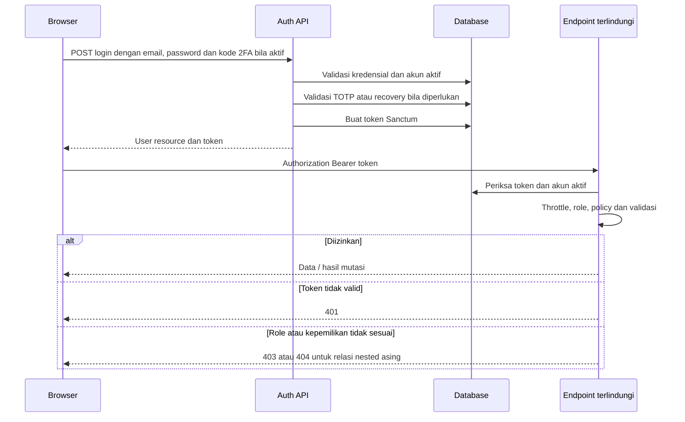
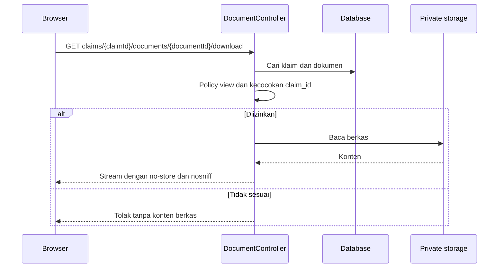
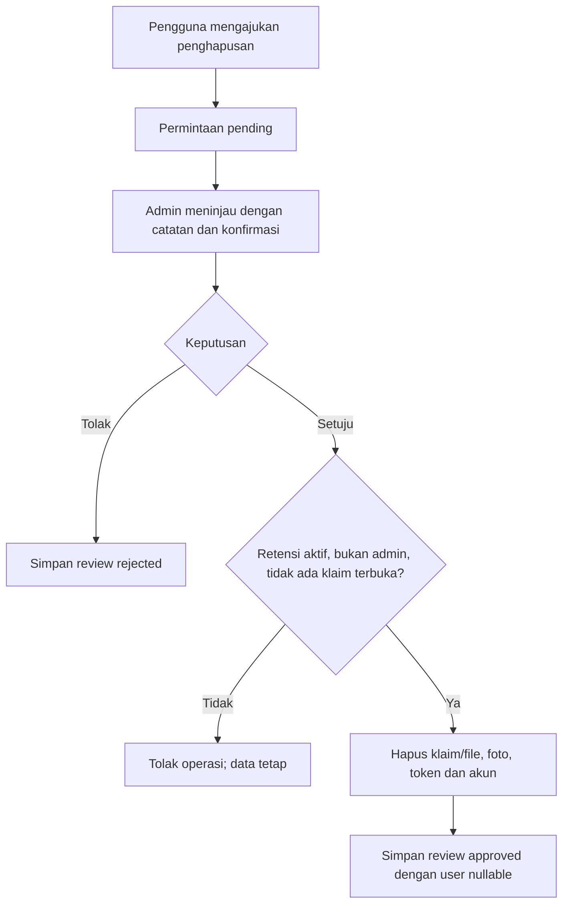

# HealthGuard Backend

API Laravel untuk autentikasi, klaim, dokumen privat, histori, kolaborasi, pembayaran dan administrasi. UI React berada di [frontend](../Health_Guard-frontend/README.md); konteks produk dan stakeholder ada di [README utama](../README.md).

Ditinjau terhadap kode pada **23 November 2026**. Base path API: `/api`. Runtime Docker/CI: **PHP 8.4**; manifest membutuhkan PHP `^8.3`, Laravel `^13.8`, Sanctum `^4.3`. Database Compose: **MySQL 8.4**. SQLite digunakan untuk lokal, sebagian tes dan sumber import.

## Daftar isi

- [Arsitektur backend](#arsitektur-backend)
- [Model data dan ERD](#model-data-dan-erd)
- [Autentikasi dan otorisasi](#autentikasi-dan-otorisasi)
- [Kontrak dan modul API](#kontrak-dan-modul-api)
- [Dokumen privat](#dokumen-privat)
- [Histori, notifikasi dan metrik](#histori-notifikasi-dan-metrik)
- [Retensi dan penghapusan](#retensi-dan-penghapusan)
- [Pengembangan lokal](#pengembangan-lokal)
- [Konfigurasi](#konfigurasi)
- [Command operasional](#command-operasional)
- [Pengujian](#pengujian)
- [Panduan perubahan](#panduan-perubahan)

## Arsitektur backend



Diagram merangkum tanggung jawab, bukan urutan middleware internal yang identik untuk semua route. Auth publik tidak membutuhkan token; download/export/SSE memiliki respons non-JSON. Sebagian workflow produk masih menggunakan transaksi langsung dalam controller, bukan semuanya melalui `ClaimService`.

| Lokasi | Tanggung jawab |
|---|---|
| [routes/api.php](routes/api.php) | Endpoint, kelompok auth/role dan throttle |
| [bootstrap/app.php](bootstrap/app.php) | Middleware alias, trusted host/proxy, JSON exception, logging SQL tersanitasi |
| [app/Http/Requests](app/Http/Requests) | Validasi auth, profil, klaim, keputusan, pagination dan unggahan |
| [app/Policies](app/Policies) | Izin baca, create, resubmit, assignment, keputusan dan dokumen |
| [app/Services](app/Services) | Transaksi klaim, histori, notifikasi, email, TOTP dan retensi |
| [app/Http/Controllers](app/Http/Controllers) | Orkestrasi endpoint dan workflow produk |
| [app/Http/Resources](app/Http/Resources) | Bentuk data yang diekspos API |
| [app/Models](app/Models) | Relasi, cast dan model domain |
| [app/Enums/ClaimStatus.php](app/Enums/ClaimStatus.php) | Lima string status dan aturan resubmit |
| [database/migrations](database/migrations) | Skema dan indeks yang berversi |
| [app/Console/Commands](app/Console/Commands) | Administrasi akun, import, privatisasi, backfill dan purge |

## Model data dan ERD

Diagram dipisah agar relasi inti dan pendukung tetap terbaca. Atribut ditampilkan secara ringkas; migration adalah sumber lengkap termasuk nullability, indeks, panjang dan aturan delete.

### Klaim dan kolaborasi



### Akun dan administrasi



Tabel lain:

| Tabel / identitas | Keterangan |
|---|---|
| `providers` | Kode unik, nama, alamat, aktif/nonaktif |
| `claim_categories` | Kode unik, nama, diagnosis_code, coverage_rules, coverage_limit |
| `claim_sequences` | `year` sebagai primary key, counter untuk ID klaim; dikunci saat create |
| `personal_access_tokens` | Token Sanctum dengan relasi polymorphic |
| `password_reset_tokens`, `sessions` | Dukungan lifecycle akun/sesi Laravel |
| `cache`, `cache_locks`, `jobs`, `job_batches`, `failed_jobs` | Infrastruktur Laravel; adanya tabel jobs tidak berarti worker terpisah berjalan |
| `client_id` | Nilai turunan `CL-%06d` dari user ID di resource, bukan kolom/PK baru |

`claims.provider_name` dan `claims.type` berupa teks, **bukan foreign key** ke provider/kategori. `disease_name` berbeda dari jenis layanan; `description` berbeda dari catatan keputusan `notes`. `notifications.claim_id` adalah referensi teks public ID tanpa constraint FK, sedangkan `documents.claim_id` memakai numeric PK klaim. Route klaim menggunakan public ID, misalnya `CLM-2026-001`.

Penghapusan klaim menghapus relasi domain dengan cascade. Actor, pengirim, analyst assignment dan beberapa relasi pengguna nullable agar record yang dipertahankan tetap dapat dibaca setelah user dihapus. Periksa migration untuk aturan per tabel.

## Autentikasi dan otorisasi



- Publik hanya dapat mendaftar sebagai `client`. Staf dibuat melalui undangan/command tepercaya.
- Klien membaca klaim sendiri; analis/admin dapat membaca semua klaim. Hanya assigned analyst boleh memutuskan; admin tidak mendapat override.
- Token default 480 menit. Logout mencabut token saat ini; logout-all/password change mencabut seluruh token. Akun nonaktif tidak boleh melanjutkan akses.
- TOTP tersedia untuk analis/admin: setup membutuhkan password, aktivasi membutuhkan konfirmasi kode; replay ditolak dan recovery code sekali pakai.
- Login: 20 request/menit per IP serta 5/menit per kombinasi identitas+IP. Named limiter register: 5/menit/IP; API: 120/menit/user; ekspor: 5/menit/user. Sumber: [AppServiceProvider](app/Providers/AppServiceProvider.php).
- Verifikasi email memakai signed URL dan akun yang cocok. Email notifikasi klaim mensyaratkan pengguna terverifikasi; endpoint klaim tidak memakai middleware wajib-verifikasi email.

## Kontrak dan modul API

Gunakan `Accept: application/json`; endpoint terlindungi membutuhkan `Authorization: Bearer <token>`. Upload memakai multipart; biarkan HTTP client menentukan boundary.

| Modul | Endpoint utama | Aturan penting |
|---|---|---|
| Auth | POST register/login/forgot-password/reset-password; GET/PUT user | UserResource tidak mengekspos password/secret |
| Akun | user/photo, logout, logout-all, email/verify, two-factor | Foto publik; password change mengharuskan autentikasi ulang |
| Klaim | GET/POST claims; GET/PUT claims/{id}; assign; status | Form Request + policy + transaksi |
| Histori | GET claims/{id}/history | Resource pagination; tidak ada API edit/delete |
| Kolaborasi | messages, document-requests | Owner/assigned analyst untuk pengiriman; admin hanya membaca |
| Dokumen | documents; documents/{documentId}/download | Ownership dan pasangan klaim-dokumen harus cocok |
| Draf | GET/POST drafts; PUT/DELETE drafts/{id} | Milik klien; data parsial, belum membuat klaim |
| Katalog | GET catalog; admin/catalog/{kind} | Provider dan kategori aktif untuk pengguna |
| Pembayaran | GET/POST claims/{id}/payment | Write admin, satu catatan, paid lalu settled |
| Notifikasi | notifications, unread-count, read-all, stream | Hanya notifikasi akun sendiri |
| Pelaporan | claims/export; analytics | Staf, filter seluruh dataset |
| Administrasi | admin/users, active, invitations, deletion-requests | Role admin dan guard domain |

Bentuk respons tidak seragam untuk semua endpoint:

- Show/create/update klaim mengembalikan objek klaim; assignment mengembalikan `{claim,message}`.
- List memakai `{data,current_page,last_page,total,...}`; histori memakai Laravel resource `{data,links,meta}`.
- Nominal decimal diserialisasi sebagai string. Tanggal lahir/layanan adalah `YYYY-MM-DD`; timestamp memiliki waktu.
- `422` validasi, `409` konflik lifecycle, `429` throttle, `401` sesi, `403` izin, `404` record/relasi/fitur yang tidak tersedia.
- Resource terkini juga mencakup `client_id`, `disease_name`, dan `description`; gunakan [ClaimResource](app/Http/Resources/ClaimResource.php), [ClaimInputRequest](app/Http/Requests/ClaimInputRequest.php) dan [routes](routes/api.php) untuk detail terbaru di luar ringkasan [kontrak API](../docs/API.md).

Keputusan menerima kelima status enum; tidak ada matriks transisi satu arah yang memaksa semua keputusan berasal dari Pending. Guard utamanya adalah role/assignment, validasi nominal/alasan, dan pembayaran. Resubmit klien terbatas pada Rejected/Needs Info/Partially Approved; assignment/catatan dipertahankan, approved amount direset, data sebelumnya disnapshot.

## Dokumen privat



Dokumen menerima PDF/JPG/PNG/DOC/DOCX, ukuran 1 byte–10 MB, dengan pemeriksaan MIME/konten dan ekstensi. Foto profil JPG/PNG maksimal 2 MB memakai disk public. Kunci `file_path` pada metadata bukan URL publik. Nginx dan Apache memblokir jalur dokumen public lama.

Klien mengunggah pada klaim sendiri; analis hanya dapat menambahkan lampiran pada pesan miliknya di klaim assigned. Upload dengan `request_id` memenuhi permintaan dokumen milik klaim tersebut. Metadata/histori database dan operasi filesystem tidak merupakan satu transaksi lintas sistem; backup/restore harus menjaga konsistensi keduanya.

## Histori, notifikasi dan metrik

Histori mencatat antara lain `submitted`, `assigned`, `status_changed`, `resubmitted`, `document_uploaded`, `message_added`, `document_requested`, `payment_paid`, `payment_settled`, serta `migrated_snapshot`. Backfill tidak mengarang keputusan lama yang tidak diketahui. Immutability pada model/API bukan pengganti pembatasan akses operator SQL.

Notifikasi tersimpan di DB. Frontend polling jumlah unread setiap 30 detik; SSE opt-in mengirim count sekitar setiap 3 detik dan koneksi berakhir sekitar 20 detik sebelum reconnect. Ini bukan WebSocket. Email opsional dikirim setelah commit dengan isi generik.

Definisi metrik:

- SLA = pengajuan awal + konfigurasi jam; resubmit tidak mereset tanggal pengajuan.
- Approval rate = Approved + Partially Approved dibagi total klaim sesuai filter.
- Rata-rata keputusan = rata-rata jam dari pengajuan awal ke event keputusan final; satu klaim dapat memiliki beberapa event.
- Statistik dan ekspor mengikuti seluruh hasil filter, bukan hanya halaman aktif. CSV menghindari formula injection; frontend mengubah CSV menjadi XLSX.

## Retensi dan penghapusan



Purge berkala adalah jalur terpisah: pilih klaim Approved/Rejected/Partially Approved dengan `updated_at` melewati `RETENTION_DAYS`. Command membutuhkan fitur aktif dan durasi positif bahkan untuk dry run. Tidak ada jadwal purge di [routes/console.php](routes/console.php); operator mengatur jadwal setelah kebijakan disahkan. Lihat [RETENTION.md](../docs/RETENTION.md).

## Pengembangan lokal

Prasyarat: PHP sesuai Composer (direkomendasikan menyamai PHP 8.4 CI), Composer 2, ekstensi yang diminta paket termasuk PDO SQLite/MySQL, mbstring, zip dan fileinfo. Jalankan dari folder backend. Contoh berikut untuk **checkout baru**, database SQLite pengembangan:

```powershell
composer install
Copy-Item .env.example .env
php -r "file_exists('database/database.sqlite') || touch('database/database.sqlite');"
php artisan key:generate
php artisan migrate
php artisan storage:link
php artisan healthguard:create-admin admin@example.test --name="Administrator"
php artisan serve --host=127.0.0.1 --port=8000
```

Bash: ganti langkah salin dengan `cp .env.example .env`. Jangan timpa env/key/data yang sudah digunakan. Default `DB_CONNECTION=sqlite` menggunakan `database/database.sqlite`; bila mengisi `DB_DATABASE`, gunakan path absolut ke file yang ada. `DB_URL` dari shell dapat mengoverride konfigurasi koneksi; pastikan tidak menunjuk database operasional.

Untuk MySQL lokal, buat database/akun terpisah lalu isi DB_CONNECTION=mysql, DB_HOST, DB_PORT, DB_DATABASE, DB_USERNAME, DB_PASSWORD sebelum migrate. Jangan menggunakan `migrate:fresh` pada data yang ingin disimpan.

Frontend lokal menggunakan origin `http://127.0.0.1:5173`. Set APP_URL backend ke `http://127.0.0.1:8000` dan FRONTEND_URL ke origin frontend. `composer dev`/`composer setup` adalah script scaffold yang juga menjalankan tooling aset backend; keduanya tidak menggantikan server React di folder frontend. Untuk API, perintah di atas cukup.

## Konfigurasi

| Konfigurasi | Fungsi |
|---|---|
| APP_ENV / APP_DEBUG | Local/testing/production; debug nonaktif pada contoh dan Compose |
| APP_KEY | Enkripsi data; pertahankan saat restore data 2FA |
| APP_URL / FRONTEND_URL | URL backend dan tautan menuju UI |
| DB_CONNECTION / DB_* / DB_URL | Database; Compose mengoverride ke service MySQL |
| LARAVEL_STORAGE_PATH | Override storage Laravel, dipakai E2E untuk isolasi |
| SANCTUM_TOKEN_EXPIRATION | Menit token, default 480 |
| FEATURE_MESSAGES / PAYMENTS | Default aktif |
| FEATURE_EMAIL / REALTIME / RETENTION | Default nonaktif |
| RETENTION_DAYS | Default 0; perlu kebijakan sebelum purge |
| CLAIM_SLA_HOURS | Default 72 |
| MAIL_* | Mailer/kredensial; array tidak mengirim email keluar |
| CACHE_STORE / SESSION_DRIVER | Database pada contoh; array untuk tes |
| QUEUE_CONNECTION | Sync; Compose tidak menyalakan worker terpisah |
| TRUSTED_HOSTS / TRUSTED_PROXIES | Daftar eksplisit hostname dan IP/CIDR proxy |
| DEMO_SEED_ENABLED | Guard fixture demo, default false |

Sumber: [.env.example](.env.example), [healthguard config](config/healthguard.php), [Compose](../compose.yaml). Nilai maksimal klaim saat ini ditetapkan di config healthguard, bukan variabel env Compose.

## Command operasional

Jalankan `php artisan <command> --help` sebelum pekerjaan data. Pada Docker, awali dengan `docker compose exec backend`.

| Command | Tujuan / batas |
|---|---|
| `healthguard:create-admin` | Admin dari terminal tepercaya; password diminta tersembunyi |
| `healthguard:create-analyst` | Alternatif operator untuk pembuatan analis |
| `healthguard:privatize-documents` | Pindahkan dokumen public lama ke private dengan verifikasi checksum |
| `healthguard:backfill-history` | Snapshot migrasi yang jujur dan idempoten |
| `healthguard:import-sqlite <path>` | Import sumber SQLite query-only ke MySQL kosong; pertahankan identitas/relasi |
| `healthguard:purge-expired` | Dry run, kebijakan aktif dan durasi wajib |
| `healthguard:purge-expired --apply` | Penghapusan nyata; review kebijakan dan backup lebih dahulu |

Seeder tidak diperlukan untuk memulai produksi. `DatabaseSeeder` hanya mengizinkan demo pada local/testing dengan flag aktif; `E2ESeeder` khusus testing. Import, backup, restore dan cutover dijelaskan di [DOCKER.md](../DOCKER.md). Jangan mengganti APP_KEY saat memulihkan data terenkripsi.

## Pengujian

Dari backend:

```sh
composer install
composer test
php vendor/bin/pint --test
```

[phpunit.xml](phpunit.xml) mengonfigurasi testing, SQLite in-memory, cache/session array dan mailer array. Jika shell mewarisi DB produksi, kosongkan override dan jalankan secara eksplisit pada lingkungan tes. Contoh PowerShell:

```powershell
$env:APP_ENV='testing'
$env:DB_CONNECTION='sqlite'
$env:DB_DATABASE=':memory:'
$env:DB_URL=''
$env:CACHE_STORE='array'
$env:SESSION_DRIVER='array'
php vendor/bin/phpunit --display-warnings
```

| Suite | Cakupan |
|---|---|
| Auth / SecurityAuth | Registrasi, kredensial, role, token, perubahan password |
| SecurityAuthorization | Kepemilikan, akses lintas akun, assignment |
| ClaimFlow / ValidationBoundary | Keputusan, resubmit, batas field/nominal/pagination |
| SecurityUpload | MIME, ekstensi, ukuran, foto dan dokumen privat |
| ProductWorkflows | Histori, draf, pesan, permintaan dokumen, pembayaran, undangan, TOTP, reset, retensi, analytics |
| MigrationAndLifecycle | Import/migrasi dan lifecycle; beberapa kasus khusus database |
| E2E di frontend | Browser dengan API nyata serta SQLite/storage disposable |

CI menjalankan matriks SQLite/MySQL, bukan hanya SQLite. Smoke, concurrency dan restore Docker berada di folder [docker](../docker). Bukti bertanggal di [bukti implementasi](../docs/archive/implementation-evidence-2026-11.md); hasil SQLite tidak membuktikan kapasitas/restore MySQL produksi.

## Panduan perubahan

1. Definisikan capability pada policy/role dan validasi input; jangan mengandalkan UI.
2. Ubah skema melalui migration, bukan perubahan database manual.
3. Pertahankan string status publik dan bentuk respons yang digunakan frontend.
4. Simpan mutasi dan event histori terkait dalam transaksi; periksa ulang state setelah lock untuk operasi bersaing.
5. Tambahkan tes negatif, ownership dan boundary sesuai perubahan; jalankan Pint dan suite relevan.
6. Perbarui resource, tipe frontend, kontrak API, diagram dan README bila perilaku berubah.

Health: `/up` untuk liveness, `/health/ready` untuk database readiness pada backend. Untuk masalah 401/403/409/422, bedakan sesi, izin, konflik lifecycle dan validasi sebelum mengubah aturan bisnis.
