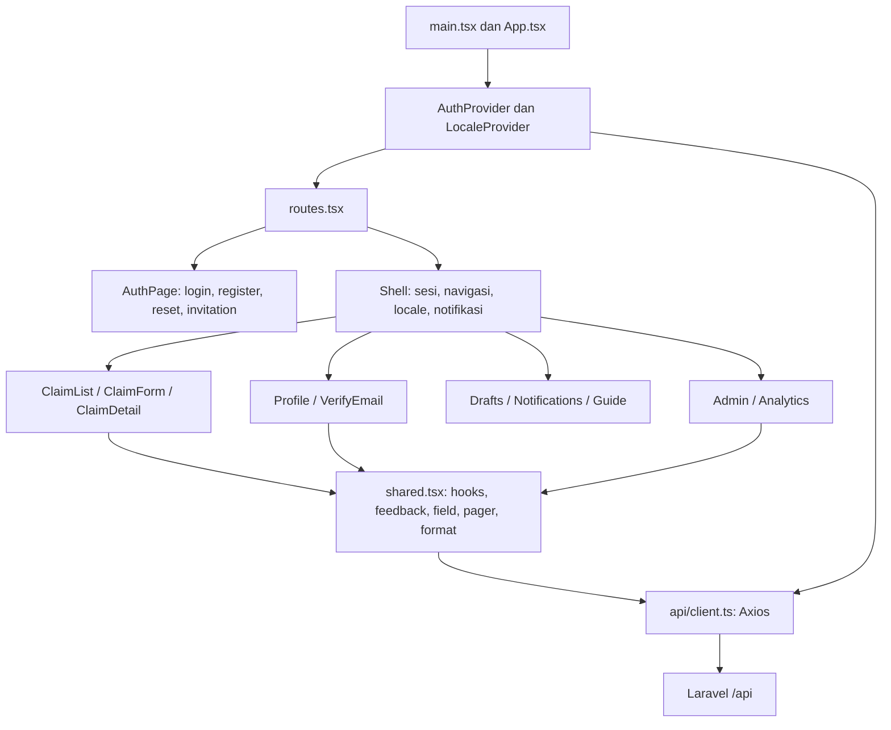
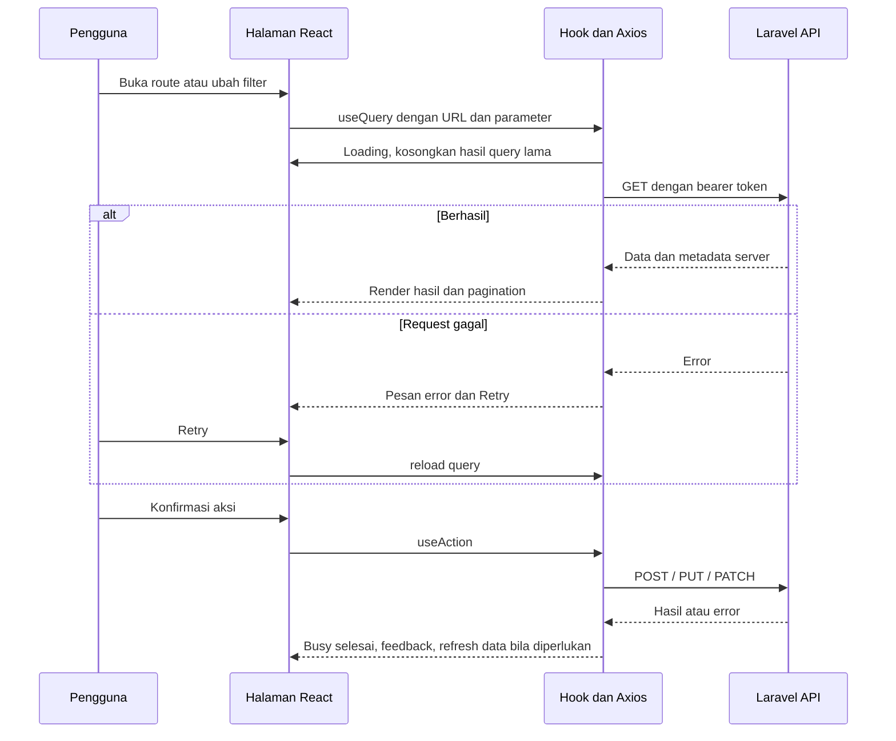
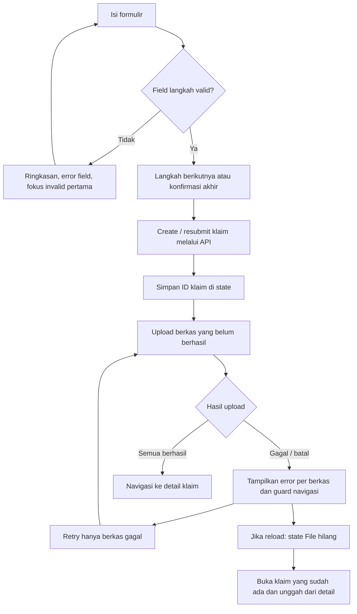
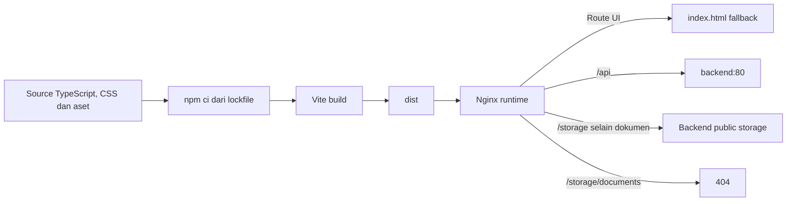

# HealthGuard Frontend

SPA React untuk klien, analis dan administrator HealthGuard. UI bisnis berada di `src/app/portal/`, berbicara dengan Laravel melalui `/api`, dan dibangun menjadi aset statis untuk Nginx.

Ditinjau pada **23 November 2026**. Konteks stakeholder/workflow ada di [README utama](../README.md); aturan otorisasi dan data ada di [README backend](../Health_Guard-backend/README.md).

## Daftar isi

- [Teknologi](#teknologi)
- [Arsitektur frontend](#arsitektur-frontend)
- [Route dan halaman](#route-dan-halaman)
- [Aliran data dan autentikasi](#aliran-data-dan-autentikasi)
- [Formulir dan pemulihan unggahan](#formulir-dan-pemulihan-unggahan)
- [Komponen bersama dan aksesibilitas](#komponen-bersama-dan-aksesibilitas)
- [Pengembangan lokal](#pengembangan-lokal)
- [Build dan deployment](#build-dan-deployment)
- [Pengujian](#pengujian)
- [Struktur file](#struktur-file)
- [Troubleshooting dan kontribusi](#troubleshooting-dan-kontribusi)

## Teknologi

Versi mengikuti [package.json](package.json); versi resolved ada di [package-lock.json](package-lock.json).

| Tool | Penggunaan |
|---|---|
| React 18.3.1 / React DOM | Rendering dan lifecycle UI |
| TypeScript ~5.8 | Tipe data dan pemeriksaan strict |
| React Router 7.13 | Route, query filter, redirect dan navigation blocker |
| Axios | Request API, bearer token, timeout 30 detik, interceptor sesi |
| Sonner | Toast sukses/error |
| SheetJS xlsx | Membuat XLSX dari CSV seluruh hasil filter yang dikirim backend |
| Vite 6.3.5 + plugin React | Dev server/proxy dan build produksi |
| CSS di src/styles | Styling portal dan autentikasi |
| ESLint / Prettier | Lint dan format |
| Vitest / Testing Library / jsdom | Tes unit/komponen dengan interaksi pengguna |
| Node test runner | Tes keamanan cookie |
| Playwright / axe-core | Browser E2E dan aksesibilitas otomatis |

Gunakan Node 22 seperti Docker/CI. Frontend tidak membutuhkan package JavaScript di folder backend. Tidak ada framework UI eksternal yang harus diinisialisasi untuk portal saat ini.

## Arsitektur frontend



Diagram menunjukkan dependensi utama, bukan daftar setiap import. Hak akses tetap diputuskan API. Shell menangani sesi dan navigasi, sedangkan halaman serta backend membatasi tindakan sesuai role.

| Bagian | Tanggung jawab |
|---|---|
| AuthContext | Restore user dari API, login/register/logout dan token |
| LocaleProvider | Pilihan ID/EN, helper teks dan atribut bahasa dokumen |
| Shell | Layout, menu responsif, logout, count notifikasi/polling atau SSE |
| ClaimList | Query filter, statistik server, pagination, CSV/XLSX untuk staf |
| ClaimForm | Empat langkah, draf, validasi, upload/retry/cancel dan guard keluar |
| ClaimDetail | Fetch berdasarkan public ID, dokumen, histori, chat, permintaan dan keputusan |
| Profile | Profil/foto, password/sesi, email, 2FA staf dan permintaan penghapusan |
| Admin / Analytics | Pengguna, undangan, katalog, review penghapusan dan metrik |
| Dialog | Native dialog, fokus, Escape dan pengembalian fokus |
| shared.tsx | useQuery/useAction, Feedback, Field, Pager, MoneyInput, format dan berkas |

## Route dan halaman

Parameter `:id` pada klaim berisi ID publik seperti `CLM-2026-001`, bukan primary key numerik.

| Route | Pengguna / fungsi |
|---|---|
| `/` | Login dan quick sign-in identitas lokal |
| `/register` | Registrasi klien |
| `/forgot-password`, `/reset-password` | Pemulihan password; backend memerlukan email terkonfigurasi |
| `/accept-invitation` | Penerimaan undangan analis |
| `/claims` | Daftar, pencarian, status/tanggal/sort dan pagination |
| `/claims/new` | Pengajuan baru oleh klien |
| `/claims/:id` | Detail untuk pemilik atau staf |
| `/claims/:id/edit` | Pengajuan ulang klien yang memenuhi aturan backend |
| `/drafts` | Draf klien |
| `/notifications` | Notifikasi akun |
| `/profile` | Profil dan keamanan akun |
| `/verify-email` | Menyelesaikan verifikasi signed URL pada sesi yang sesuai |
| `/guide` | Panduan penggunaan |
| `/analytics` | Metrik staf |
| `/admin` | Administrasi |
| Route lainnya | Halaman 404 |

Redirect kompatibilitas: `/client` dan `/analyst` → `/claims`; `/client/submit` → `/claims/new`; `/client/profile` dan `/analyst/settings` → `/profile`; `/client/guide` → `/guide`; `/analyst/review/:id` → `/claims/:id`; antrean lama → `/claims?scope=unassigned` atau `scope=assigned`.

Sumber lengkap: [routes.tsx](src/app/routes.tsx). Detail klaim mengambil data berdasarkan URL sehingga refresh/deep link tidak bergantung pada cache daftar.

## Aliran data dan autentikasi



- Axios menggunakan base URL `/api`, header Accept JSON dan timeout 30 detik. Token ditambahkan dari `localStorage.auth_token`.
- Restore sesi mengambil `GET /user`, bukan mempercayai profil lama di storage. Respons 401 atau `reauthenticate=true` membersihkan sesi dan mengarahkan ke login bila perlu.
- Quick sign-in memakai cookie identitas nama/email/role; password tetap harus dimasukkan. Cookie lama yang mengandung password dibersihkan.
- `useQuery` membatalkan request usang dengan AbortController dan memisahkan data/loading/error/reload. Query baru tidak menampilkan data lama sebagai hasil terkini.
- Filter dan halaman daftar berada di URL. Statistik berasal dari server untuk seluruh hasil filter.
- Notifikasi default polling 30 detik; jika flag realtime aktif, SSE mengirim count dan reconnect. Ini bukan sinkronisasi real-time untuk seluruh data halaman/chat.
- Draft/dokumen pasien tidak disimpan sebagai payload persisten di localStorage. State file dan progres upload hidup selama halaman terbuka.

## Formulir dan pemulihan unggahan

| Langkah | Data dan perilaku |
|---|---|
| 1. Pasien | Nama/DOB dari profil sebagai awal; bisa berbeda untuk pasien; ID klien read-only dari akun |
| 2. Layanan | Rumah sakit, penyakit, jenis layanan, tanggal layanan, nominal dan keterangan |
| 3. Dokumen | Pilih berkas pendukung dan hapus pilihan yang tidak diperlukan |
| 4. Tinjau | Ringkasan, nama berkas dan konfirmasi sebelum mengirim |

Penyakit berbeda dari jenis layanan; keterangan klien berbeda dari catatan keputusan analis. Profil menyimpan BPJS, tetapi UI formulir terkini menampilkan ID klien sebagai identitas akun. Nominal ditampilkan dengan pengelompokan ribuan dan dikirim sebagai nilai numerik yang dinormalisasi; API tetap menjadi sumber validasi batas nominal.



Retry upload tidak membuat klaim kedua dan tidak mengirim ulang berkas yang telah diakui berhasil. Jaminan ini berlaku pada pemulihan state yang diuji, bukan klaim idempotensi universal untuk semua kondisi putus jaringan setelah server menerima request.

Draf disimpan di server dan dapat dilanjutkan, tetapi File browser tidak ikut tersimpan. Guard navigasi/reload memperingatkan perubahan belum tersimpan atau upload belum selesai. Jangan membuat klaim baru untuk mengganti klaim yang sebenarnya sudah berhasil dibuat.

## Komponen bersama dan aksesibilitas

- Perubahan langkah memfokuskan heading langkah; Tab berikutnya menuju input pertama. Langkah aktif memakai `aria-current="step"`.
- Validasi menandai `aria-invalid`, menampilkan alert/ringkasan serta error field. Nama field pada ringkasan tidak mencampur teks bantuan.
- Pagination memiliki nama tombol ID/EN. Landmark pagination chat/histori serta pengguna/penghapusan dibedakan.
- Native dialog menangani focus trap/Escape dan mengembalikan fokus ke pemicu. Drawer navigasi mobile memakai dialog.
- Loading memakai role status, error memakai alert, dan status klaim memiliki teks agar tidak bergantung pada warna.
- Format nilai menggunakan helper bersama: IDR dan timestamp Asia/Jakarta; tanggal layanan/DOB tetap tanggal kalender.
- Locale disimpan di browser dan memperbarui `html.lang`. Gaya fokus terlihat dan reduced-motion didukung.
- Tabel lebar dapat bergulir di container sendiri; overflow halaman diuji pada lebar mobile/tablet/desktop.

QA otomatis mencakup axe, semantik, keyboard, fokus dan screenshot. Itu tidak menyatakan semua kombinasi browser/teknologi bantu atau pembacaan suara NVDA/VoiceOver telah diuji. Cakupan disepakati ada di [QA](../docs/QA.md).

## Pengembangan lokal

Prasyarat: Node 22/npm serta backend berjalan di port 8000. Dari folder frontend:

```sh
npm ci
npm run dev
```

Buka **http://127.0.0.1:5173**. [vite.config.ts](vite.config.ts) meneruskan `/api` dan `/storage` ke `http://127.0.0.1:8000`. Tidak perlu URL backend absolut di Axios.

Untuk backend pada alamat lain, atur **environment proses** sebelum Vite:

```powershell
$env:VITE_BACKEND_URL='http://127.0.0.1:8001'
npm.cmd run dev
```

Bash: `VITE_BACKEND_URL=http://127.0.0.1:8001 npm run dev`. Konfigurasi Vite saat ini membaca `process.env.VITE_BACKEND_URL`; jangan menganggap menulis variabel ke file env frontend saja otomatis mengubah proxy tanpa pemuatan env dalam config. Nilai ini mengatur proxy dev, bukan alamat upstream Nginx produksi.

Pada PowerShell yang memblokir `npm.ps1`, gunakan `npm.cmd` dan `npx.cmd`, tanpa mengubah execution policy. Setup Laravel ada di [README backend](../Health_Guard-backend/README.md#pengembangan-lokal).

## Build dan deployment

```sh
npm run typecheck
npm run lint
npm run build
```

Output ada di `dist/`. Build Vite tidak menggantikan typecheck; jalankan keduanya. [Dockerfile](Dockerfile) menggunakan Node 22 untuk build lalu menyalin dist ke Nginx. Node tidak menjadi server runtime produksi.



Konfigurasi [Nginx](docker/default.conf) menyediakan `/healthz`, batas request 12 MB, proxy API/storage, penolakan dokumen publik dan fallback SPA. Validasi per file backend tetap lebih ketat. TLS dan konfigurasi origin publik mengikuti [runbook](../DOCKER.md). Jangan menyisipkan secret ke variabel frontend atau bundle browser.

## Pengujian

| Perintah | Fungsi |
|---|---|
| `npm run typecheck` | TypeScript tanpa emit |
| `npm run lint` | ESLint src dan tests |
| `npm test` | Seluruh Vitest sekali jalan |
| `npm run test:watch` | Vitest watch untuk pengembangan |
| `npm run test:security` | Node tests untuk cookie identitas/migrasi |
| `npm run build` | Build produksi |
| `npm run test:e2e` | Playwright dengan backend nyata disposable |
| `npm run format` | Memformat source/test yang ditetapkan script; mengubah file |

Instal dependensi backend terlebih dahulu agar PHP E2E dapat memuat Laravel. Untuk browser bawaan Playwright:

```sh
npx playwright install chromium
npm run test:e2e
```

Untuk Chrome Windows yang sudah terpasang:

```powershell
$env:PLAYWRIGHT_CHANNEL='chrome'
npm.cmd run test:e2e
```

`msedge` juga dapat dipilih bila terpasang. Config memakai satu worker, base URL port 4173, backend PHP port 8011, timeout tes 180 detik, serta satu retry pada CI. Pastikan kedua port kosong.

[test server](tests/e2e/server.mjs) membuat SQLite dan storage pada direktori sementara, menggunakan `APP_ENV=testing`, key acak, cache/session/mail array, migrasi dan E2ESeeder. Database deployment tidak digunakan. Teardown menghentikan server; interupsi paksa dapat meninggalkan proses/artefak sementara, sehingga periksa port sebelum run baru.

| File/suite | Cakupan |
|---|---|
| auth.test.tsx / api-client.test.ts | Restore, login/logout, token dan interceptor 401/reauthenticate |
| navigation.test.tsx | Proteksi route, notifikasi, count dan navigasi |
| portal.test.tsx | History/status, form/draf/retry, fokus, pagination, format nominal dan chat |
| tests/security | Cookie allowlist, pembersihan payload password lama, input invalid |
| claims-matrix.spec.ts | Registrasi, penolakan, resubmit, partial approval, dokumen dan akses privat |
| keyboard.spec.ts | Alur klien/analis via keyboard, dialog, preview, overflow dan axe |
| profile-admin.spec.ts | Persistensi profil/provider dan axe/landmark ID/EN |
| qa-states.spec.ts | Loading, gagal request/retry, empty, token dicabut, semantik/error/fokus ID/EN |
| upload-recovery.spec.ts | Satu upload diputus; retry tanpa klaim/dokumen ganda |
| workflows.spec.ts | Needs Info, resubmit, approval, draf, locale dan responsivitas |

Hasil HTML: `playwright-report/index.html`; screenshot/trace gagal: `test-results/`. Jangan commit trace yang dapat memuat token/data. Output run terarah historis `test-results-final/` juga diabaikan Git. Bukti **22 November 2026**: 33 tes komponen, 5 tes cookie, 9 browser serta 2 tes ulang terarah lulus. Rincian revisi dan batas verifikasi ada di [bukti implementasi](../docs/archive/implementation-evidence-2026-11.md) dan [TEST-COVERAGE.md](../docs/TEST-COVERAGE.md); jumlah itu bukan klaim run ulang pada setiap perubahan dokumentasi.

## Struktur file

```text
src/
├── main.tsx
├── app/
│   ├── App.tsx                 # Provider, router dan toast
│   ├── routes.tsx              # Route aktif dan redirect lama
│   ├── api/client.ts           # Axios dan interceptor
│   ├── state/AuthContext.tsx   # Sesi akun
│   ├── utils/cookies.ts        # Identitas quick sign-in
│   └── portal/
│       ├── AuthPage.tsx
│       ├── Shell.tsx           # Layout, notifikasi dan panduan
│       ├── ClaimList.tsx
│       ├── ClaimForm.tsx       # Form dan draf
│       ├── ClaimDetail.tsx
│       ├── Profile.tsx
│       ├── Admin.tsx           # Administrasi dan analytics
│       ├── Dialog.tsx
│       ├── shared.tsx
│       ├── locale.tsx
│       └── types.ts
├── assets/
└── styles/
tests/                          # Komponen, security, E2E
docker/default.conf             # Nginx produksi
```

Scaffold komponen lama dan salinan PHP `_gen` bukan bagian runtime frontend saat ini.

## Troubleshooting dan kontribusi

| Gejala | Tindakan |
|---|---|
| API gagal di dev | Backend hidup, target proxy benar, token valid; lihat respons Network |
| Muncul login setelah password berubah | Diharapkan: backend meminta reauthentication |
| 403/409 pada aksi | Periksa role/ownership/assignment/status/pembayaran, jangan bypass API |
| Klaim ada tetapi upload gagal | Retry file yang gagal atau lanjutkan dari detail, jangan buat klaim kedua |
| Berkas hilang setelah resume draf | File browser tidak disimpan; pilih ulang |
| Statistik berbeda dari jumlah baris | Statistik mencakup seluruh filter, tabel hanya satu halaman |
| Ekspor tak tersedia pada klien | Fitur ekspor hanya staf |
| Deep link produksi 404 | Periksa fallback index.html di server |
| Axe lulus tetapi teknologi bantu bermasalah | Tambahkan reproduksi semantik/fokus; axe bukan bukti pengalaman seluruh screen reader |

Untuk perubahan UI: gunakan komponen/helper bersama, tambahkan ID/EN, pertahankan validasi API, kelola loading/error/empty, periksa keyboard dan mobile. Sinkronkan tipe/resource ketika kontrak API berubah, lalu jalankan tes yang relevan. Perubahan skema/izin ditangani di backend bersama tes negatifnya.
