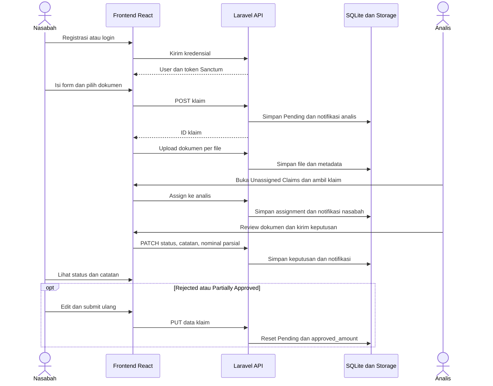
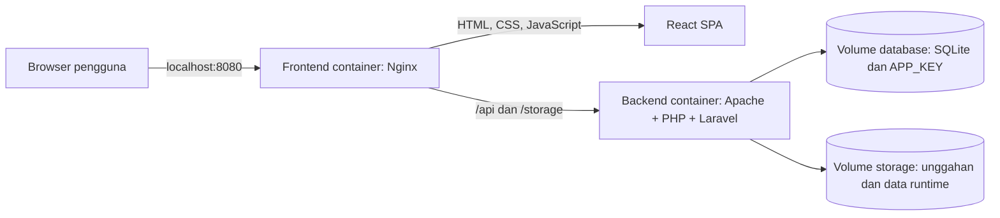

# HealthGuard — Sistem Manajemen Klaim Asuransi Kesehatan

HealthGuard adalah aplikasi web untuk mengajukan, meninjau, dan memantau klaim asuransi kesehatan. Nasabah mengirim data klaim beserta dokumen pendukung, sementara analis mengambil penugasan dan memberikan keputusan. Aplikasi menggunakan frontend React dan REST API Laravel, serta dapat dijalankan melalui Docker Desktop.

Dokumen ini menjelaskan workflow stakeholder, arsitektur, tools, cara menjalankan aplikasi, dan batasan implementasi berdasarkan kode yang tersedia.

## Daftar isi

- [Ruang lingkup](#ruang-lingkup)
- [Stakeholder dan tanggung jawab](#stakeholder-dan-tanggung-jawab)
- [Workflow bisnis](#workflow-bisnis)
- [Status dan aturan klaim](#status-dan-aturan-klaim)
- [Arsitektur aplikasi](#arsitektur-aplikasi)
- [Teknologi dan tools](#teknologi-dan-tools)
- [Struktur proyek](#struktur-proyek)
- [Menjalankan dengan Docker Desktop](#menjalankan-dengan-docker-desktop)
- [Pengembangan tanpa Docker](#pengembangan-tanpa-docker)
- [Workflow tim pengembang](#workflow-tim-pengembang)
- [API dan model data](#api-dan-model-data)
- [Pengujian](#pengujian)
- [Batasan implementasi saat ini](#batasan-implementasi-saat-ini)
- [Pemecahan masalah](#pemecahan-masalah)

## Ruang lingkup

Fitur utama yang tersedia:

- Registrasi member, login/logout, dan pengalihan halaman berdasarkan role.
- Login dan Create Account dengan desain biru muda serta tata letak responsif.
- Form pengajuan klaim empat tahap, pengunggahan dokumen, dan daftar klaim nasabah.
- Daftar klaim belum ditugaskan, pengambilan assignment, dan peninjauan oleh analis.
- Keputusan penuh, parsial, penolakan, atau permintaan informasi tambahan.
- Notifikasi dalam aplikasi untuk klaim baru, assignment, dan perubahan status.
- Profil pengguna, data tanggal lahir/BPJS, dan endpoint pengelolaan foto profil.
- Ekspor Excel pada dashboard analis.

Pencatatan nomor BPJS bukan integrasi dengan layanan BPJS. Aplikasi belum menjalankan pencairan pembayaran, verifikasi polis eksternal, maupun integrasi rumah sakit. Status `Approved` menunjukkan keputusan review, bukan bukti transfer dana.

## Stakeholder dan tanggung jawab

Role autentikasi yang tersedia hanya **`client`** dan **`analyst`**. Stakeholder teknis di bawah adalah pembagian tanggung jawab pengelolaan proyek, bukan role tambahan di aplikasi.

| Stakeholder | Tujuan dan tanggung jawab | Halaman atau tools | Hasil pekerjaan |
|---|---|---|---|
| Nasabah / Client | Melengkapi profil, mengajukan klaim, mengunggah bukti, memantau keputusan, dan memperbaiki klaim | Browser; Create Account; Client Dashboard; Submit Claim; Profile; Guide; notifikasi | Klaim dan dokumen yang dapat ditinjau |
| Analis / Analyst | Mengambil klaim, meninjau informasi serta dokumen, menetapkan status, nominal parsial, dan catatan | Browser; Analyst Dashboard; Unassigned Claims; My Assignments; Claim Review; Settings; ekspor Excel | Penugasan dan keputusan klaim |
| Tim frontend | Mengembangkan halaman, validasi form, navigasi, dan komunikasi API | React, TypeScript, Vite, Tailwind CSS, Axios, React Router, browser DevTools | Antarmuka dan integrasi frontend |
| Tim backend | Mengelola API, validasi, autentikasi, relasi data, migrasi, dan penyimpanan dokumen | Laravel, PHP, Sanctum, Eloquent, Artisan, Composer, SQLite | API dan penyimpanan data |
| QA / Penguji | Memverifikasi alur dua role, validasi, akses data, upload, dan regresi | PHPUnit, smoke test Docker, browser; HTTP client opsional seperti Postman | Hasil uji dan laporan masalah |
| Operator / Pengelola lingkungan | Membangun image, menjalankan layanan, memeriksa log, dan menjaga volume data | Docker Desktop, Docker Compose, Nginx, Apache, PowerShell/terminal | Lingkungan aplikasi yang berjalan |

Fasilitas kesehatan/provider dicatat sebagai nama pada klaim; belum memiliki akun atau portal tersendiri. Belum tersedia dashboard admin, role manajer, atau mekanisme persetujuan berjenjang.

## Workflow bisnis

### 1. Registrasi dan akses akun

1. Nasabah membuka `/register` dari tautan **Create an account** pada login.
2. Nasabah mengisi nama, email, password, konfirmasi password, dan tanggal lahir opsional.
3. Frontend memeriksa nama, format email, password minimal delapan karakter, dan kecocokan konfirmasi.
4. Backend memvalidasi data, termasuk keunikan email, lalu membuat akun. Halaman registrasi mengirim role `client`.
5. Backend mengembalikan user dan token Sanctum. Frontend menyimpannya di `localStorage` dan membuka `/client`.
6. Pada login berikutnya, role `client` diarahkan ke `/client`, sedangkan `analyst` ke `/analyst`.

Untuk lingkungan demo, akun analis dapat disediakan menggunakan seeder. Tidak ada halaman khusus pengelolaan akun analis.

### 2. Nasabah mengajukan klaim

| Tahap | Aktivitas nasabah | Proses atau hasil |
|---|---|---|
| Patient Info | Mengisi nama pasien, tanggal lahir, dan nomor BPJS | Nilai profil dapat digunakan untuk mengisi form awal; frontend memeriksa kelengkapan |
| Provider Details | Mengisi tanggal layanan, provider, kondisi/jenis klaim, dan biaya | Frontend memeriksa field wajib serta nominal lebih dari nol |
| Upload Documents | Memilih dokumen pendukung | Backend menerima PDF, JPG/JPEG, PNG, maksimal 10 MB per file |
| Review | Memeriksa ringkasan lalu mengirim | Frontend membuat klaim melalui API, kemudian mengunggah file satu per satu |

Backend memberikan ID publik berformat `CLM-YYYY-XXX`, menyimpan status awal `Pending`, dan membuat notifikasi untuk seluruh analis. Nomor urut bertambah berdasarkan klaim pada tahun berjalan.

Pembuatan klaim dan upload dokumen merupakan request terpisah. Jika upload gagal setelah klaim dibuat, klaim dapat tetap tersimpan; proses ini belum berupa satu transaksi atomik.

### 3. Analis mengambil penugasan

1. Analis login lalu membuka **Unassigned Claims**.
2. Daftar menampilkan klaim `Pending` yang belum memiliki `assigned_to`.
3. Analis memilih aksi pengambilan klaim. Frontend mengirim `POST /api/claims/{id}/assign`.
4. Backend memeriksa role analis dan menolak klaim yang sudah ditugaskan dengan respons `409`.
5. Klaim dihubungkan dengan analis dan dapat dilihat melalui **My Assignments**.
6. Nasabah memperoleh notifikasi bahwa klaim sedang ditinjau.

Assignment tidak mengubah status menjadi status baru bernama “Under Review”; nilai status klaim tetap seperti sebelumnya.

### 4. Analis meninjau dan memberi keputusan

1. Buka klaim dari dashboard atau daftar penugasan.
2. Periksa data pasien, provider, nominal, nomor BPJS, dan dokumen pendukung.
3. Gunakan document viewer untuk melihat dokumen; tersedia kontrol tampilan sesuai jenis file.
4. Pilih status dan isi catatan yang relevan.
5. Untuk `Partially Approved`, frontend meminta nominal **approved amount**.
6. Simpan keputusan melalui `PATCH /api/claims/{id}/status`.
7. Backend menyimpan perubahan dan membuat notifikasi untuk pemilik klaim.

Dashboard analis juga menyediakan filter dan ekspor Excel. Ekspor berasal dari data yang dimuat di frontend; jangan menganggapnya sebagai ekspor seluruh database lintas halaman.

### 5. Nasabah menindaklanjuti keputusan

1. Nasabah membuka dashboard atau notifikasi dan membaca status serta catatan.
2. Untuk `Rejected` atau `Partially Approved`, dashboard menyediakan aksi edit dan submit ulang.
3. Nasabah memperbaiki data dan dapat menambahkan dokumen melalui form klaim.
4. Backend mengembalikan status menjadi `Pending` dan mengosongkan `approved_amount`.
5. Assignment lama tetap disimpan, sehingga klaim tidak otomatis kembali ke daftar unassigned.

Status `Needs Info` sudah tersedia, tetapi tombol resubmit pada dashboard saat ini hanya muncul untuk `Rejected` dan `Partially Approved`. Alur melengkapi informasi untuk `Needs Info` belum selesai di UI.

### Diagram alur lintas stakeholder



### Notifikasi

| Pemicu | Penerima | Tipe |
|---|---|---|
| Klaim baru dibuat | Semua akun analis | `claim_submitted` |
| Klaim diambil analis | Pemilik klaim | `claim_assigned` |
| Status diperbarui | Pemilik klaim | `status_changed` |

Frontend memeriksa jumlah notifikasi belum dibaca setiap **30 detik**. Mekanisme ini adalah polling, bukan WebSocket. Pengguna dapat menandai satu atau seluruh notifikasi sebagai dibaca. Submit ulang belum membuat notifikasi baru di controller.

## Status dan aturan klaim

| Status | Makna dalam aplikasi | Tindak lanjut |
|---|---|---|
| `Pending` | Menunggu keputusan | Analis mengambil atau melanjutkan review |
| `Approved` | Disetujui penuh | Nasabah melihat keputusan; tidak ada proses pembayaran otomatis |
| `Rejected` | Ditolak | Nasabah dapat edit dan submit ulang dari dashboard |
| `Needs Info` | Membutuhkan informasi tambahan | Catatan dapat dibaca; aksi resubmit khusus status ini belum tersedia di dashboard |
| `Partially Approved` | Disetujui sebagian | Analis mengisi nominal parsial; nasabah dapat submit ulang |

API menerima kelima status tersebut dan belum menerapkan aturan transisi status yang ketat. Policy membatasi kepemilikan klaim/dokumen dan keputusan hanya untuk analis yang ditugaskan; lihat [catatan keamanan](#keamanan-p0) dan [batasan implementasi](#batasan-implementasi-saat-ini).

## Arsitektur aplikasi



- **Frontend:** React Router menentukan halaman; `AuthContext` mengelola sesi dan `ClaimContext` mengelola data klaim. Axios menggunakan base URL `/api` dan menyisipkan Bearer token.
- **Backend:** routing API menuju controller, validasi request, model Eloquent, database, dan filesystem.
- **Docker:** Node membangun frontend menjadi aset statis; Nginx menyajikannya dan meneruskan request API ke Apache. Port backend tidak dipublikasikan ke host.
- **Persistensi:** SQLite dan kunci aplikasi berada di `healthguard_database`; unggahan serta direktori storage berada di `healthguard_storage`.
- **Startup:** backend membuat kunci jika belum ada, menjalankan migrasi, dan menyiapkan symlink storage. Frontend dimulai setelah healthcheck backend lolos.
- **Queue:** Compose memakai `QUEUE_CONNECTION=sync`, sehingga tidak menjalankan worker terpisah.

## Teknologi dan tools

Versi berikut mengacu pada manifest proyek dan Dockerfile, bukan klaim versi terbaru. Resolusi paket tepatnya berada di `package-lock.json` dan `composer.lock`.

| Lapisan | Teknologi / tools | Fungsi |
|---|---|---|
| Antarmuka | React 18.3.1, TypeScript/TSX | Komponen dan interaksi halaman |
| Build frontend | Vite 6.3.5, npm | Dev server, instalasi dependensi, bundling produksi |
| Styling | Tailwind CSS 4.1.12, CSS khusus, Radix UI | Gaya halaman dan komponen UI |
| Navigasi | React Router 7.13.0 | Routing SPA dan pemisahan halaman per role |
| HTTP | Axios `^1.17.0` | Request API, Bearer token, penanganan `401` |
| Ikon | Lucide React | Ikon form, navigasi, status, dan aksi |
| Ekspor | XLSX `^0.18.5` | Pembuatan file Excel dari dashboard analis |
| Backend | Laravel `^13.8`, PHP `^8.3` | REST API dan logika aplikasi; image Docker memakai PHP 8.4 |
| Autentikasi | Laravel Sanctum `^4.3` | Penerbitan dan pencabutan token API |
| Data | SQLite, Eloquent, Laravel migrations | Penyimpanan dan perubahan skema |
| Dependensi backend | Composer | Instalasi paket PHP dari lockfile |
| CLI aplikasi | Artisan | Migrasi, seeding, cache konfigurasi, dan perintah Laravel |
| Pengujian backend | PHPUnit `^12.5.12` | Tes autentikasi dan alur klaim; memerlukan dependensi development |
| Format PHP | Laravel Pint | Formatter yang tersedia sebagai dependensi development |
| Container | Docker Desktop, Docker Compose | Build, jaringan, healthcheck, dan volume |
| Web server | Nginx `stable-alpine`, Apache pada image PHP | Aset SPA, reverse proxy, dan eksekusi backend |
| Build di Docker | Node 22 Alpine | Membangun bundle frontend |
| Verifikasi container | `docker/smoke.php` | Tes HTTP lintas frontend, API, database, dan storage |

Manifest frontend juga memuat library seperti Recharts, Motion, dan React Hook Form. Keberadaan dependensi tidak berarti semua fiturnya digunakan pada setiap halaman. Editor/IDE, Git, browser DevTools, atau Postman dapat digunakan oleh tim; tidak diwajibkan untuk menjalankan container.

## Struktur proyek

```text
Healtguard/
├── README.md                       # Panduan utama dan workflow stakeholder
├── DOCKER.md                       # Operasional Docker lebih rinci
├── compose.yaml                    # Layanan, jaringan, environment, volume
├── docker/smoke.php                 # Pengujian integrasi container
├── Health_Guard-frontend/
│   ├── src/app/pages/               # Login, registrasi, halaman client/analis
│   ├── src/app/components/          # Layout, navigasi, UI, notifikasi
│   ├── src/app/state/               # AuthContext dan ClaimContext
│   ├── src/app/api/client.ts        # Konfigurasi Axios
│   ├── src/app/routes.tsx           # Definisi routing
│   ├── src/assets/                  # Aset gambar
│   ├── src/styles/                  # Tema dan CSS login/registrasi
│   ├── _gen/                       # Salinan kode PHP; bukan backend runtime
│   ├── docker/default.conf         # Konfigurasi Nginx
│   └── Dockerfile
└── Health_Guard-backend/
    ├── app/Http/Controllers/        # Auth, Claim, Document, Notification
    ├── app/Models/                  # User, Claim, Document, Notification
    ├── routes/api.php              # Endpoint API
    ├── database/migrations/        # Skema database
    ├── database/seeders/           # Data demo
    ├── tests/                     # Tes PHPUnit
    ├── storage/                   # File runtime untuk mode lokal
    ├── docker/                    # Apache, PHP upload limits, entrypoint
    └── Dockerfile
```

Backend aktif berada di `Health_Guard-backend`; perubahan pada `_gen` frontend tidak mengubah layanan Laravel.

## Menjalankan dengan Docker Desktop

Prasyarat: Docker Desktop aktif dengan **Linux containers**, Docker Compose, serta koneksi internet saat build pertama. PHP, Composer, dan Node tidak perlu dipasang pada host untuk mode ini.

Jalankan dari direktori utama proyek:

```powershell
docker compose up -d --build --wait
docker compose ps
```

Buka **http://localhost:8080**. Di Docker Desktop, layanan berada dalam stack **healthguard**.

Database container pertama kali kosong. Gunakan **Create Account** untuk membuat nasabah. Database lokal dan `.env` lokal tidak disalin ke image atau diubah oleh proses ini.

### Akun demo

Untuk membuat akun analis, nasabah, dan contoh klaim pada database baru, jalankan seeder **sekali**:

```powershell
docker compose exec backend php artisan db:seed --force
```

| Role | Email | Password demo |
|---|---|---|
| Analyst | `analyst@healthguard.com` | `password` |
| Client | `client@healthguard.com` | `password` |

Seeder belum idempotent; menjalankannya kembali ketika akun tersebut sudah ada dapat menghasilkan konflik data. Kredensial ini untuk demo lokal.

### Perintah operasional

```powershell
# Log aplikasi
docker compose logs --tail=100 backend frontend

# Rebuild setelah perubahan kode
docker compose up -d --build --wait

# Hentikan layanan dan pertahankan volume
docker compose down

# Jalankan kembali image yang sudah dibangun
docker compose up -d --wait
```

Jangan gunakan `docker compose down -v` jika ingin mempertahankan data. Bind port default hanya ke `127.0.0.1`; konfigurasi ini ditujukan untuk akses lokal. Penggantian port dan detail volume dijelaskan di [DOCKER.md](DOCKER.md).

## Pengembangan tanpa Docker

Gunakan PHP 8.4 agar sesuai image Docker dan kebutuhan PHPUnit 12, Composer, Node 22, npm, serta ekstensi PHP yang diperlukan Composer termasuk PDO SQLite. Jalankan frontend dan backend pada terminal terpisah.

### Terminal backend

Contoh PowerShell untuk setup awal; penyalinan `.env` dan pembuatan SQLite hanya dilakukan jika file belum ada:

```powershell
cd Health_Guard-backend
composer install
if (!(Test-Path .env)) { Copy-Item .env.example .env }
if (!(Test-Path database/database.sqlite)) {
    New-Item -ItemType File database/database.sqlite | Out-Null
}
```

Pastikan `.env` memakai `DB_CONNECTION=sqlite`. Pada instalasi baru dengan `APP_KEY` kosong, jalankan `php artisan key:generate` sekali. Jangan mengganti kunci instalasi yang sudah berisi data tanpa kebutuhan yang jelas.

```powershell
php artisan migrate
php artisan storage:link
php artisan serve
```

Backend tersedia di `http://localhost:8000`. Perintah `storage:link` diperlukan sekali untuk akses file publik.

### Terminal frontend

```powershell
cd Health_Guard-frontend
npm.cmd ci
npm.cmd run dev
```

Buka `http://localhost:5173`. Vite mem-proxy `/api` dan `/storage` ke `http://localhost:8000`. Pada shell selain PowerShell Windows, gunakan `npm` sebagai pengganti `npm.cmd`.

Database lokal terpisah dari database dalam volume Docker. Akun yang dibuat di salah satu lingkungan tidak otomatis tersedia di lingkungan lainnya.

## Workflow tim pengembang

| Tahap | Penanggung jawab | Aktivitas | Tools dan hasil |
|---|---|---|---|
| Analisis kebutuhan | Pemilik kebutuhan bersama nasabah/analis | Tentukan data, status, dan kriteria penerimaan | Diskusi alur; daftar kebutuhan yang dapat diuji |
| Implementasi UI | Frontend | Ubah pages/components, validasi, dan state | Editor, Vite, browser DevTools; halaman yang terhubung ke API |
| Implementasi API | Backend | Ubah routes/controller/model dan buat migration jika skema berubah | Composer, Artisan, Eloquent; API dan migrasi |
| Verifikasi | Developer dan QA | Jalankan tes terkait perubahan, build frontend, dan periksa dua role | PHPUnit, Vite build, smoke test, browser |
| Integrasi container | Pengelola lingkungan | Build image, tunggu healthcheck, periksa log dan akses | Docker Compose/Desktop; layanan sehat |
| Uji penerimaan | Nasabah/analis bersama QA | Jalankan contoh pengajuan sampai keputusan dan submit ulang | Browser; hasil sesuai kriteria penerimaan |
| Operasional | Pengelola lingkungan | Pantau log dan lindungi database, key, serta unggahan | Docker volumes dan prosedur backup tim |

Tabel ini merupakan alur kerja tim yang disarankan. Pipeline CI/CD, penjadwalan backup, dan sistem audit keputusan belum disediakan otomatis oleh proyek.

### Auto-sync ke GitHub

Repo ini menyertakan `auto-sync.ps1` untuk commit dan push otomatis setiap ada perubahan file. Pasang alias sekali per clone:

```powershell
git config --local alias.autosync '!powershell -NoProfile -ExecutionPolicy Bypass -File ./auto-sync.ps1'
```

Jalankan dari folder mana pun di dalam repo:

```powershell
git autosync
```

Watcher berjalan sampai `Ctrl+C`. Perubahan di-commit setelah 3 detik tanpa perubahan lain, lalu di-push ke `origin/main`.

| Perintah | Fungsi |
|---|---|
| `git autosync -Once` | Sinkronisasi sekali lalu keluar |
| `git autosync -Pull` | Ambil perubahan remote sebelum push |
| `git autosync -IntervalSeconds 5 -DebounceSeconds 5` | Ubah interval cek dan waktu tunggu |
| `git autosync -Branch develop` | Sinkronisasi branch lain |

Catatan: terminal harus tetap terbuka dan log tersimpan di `.git/autosync.log`. Jika push ditolak karena remote lebih baru, jalankan `git autosync -Pull` atau `git pull --rebase`, lalu ulangi. Konflik harus diselesaikan manual.

## API dan model data

Seluruh endpoint berikut memakai awalan **`/api`**. Hanya register dan login yang publik, keduanya dibatasi rate limit. Endpoint lainnya memakai `auth:sanctum`, rate limit API, dan `Authorization: Bearer <token>`. Endpoint `/demo-users` telah dihapus (404).

| Area | Method dan endpoint | Fungsi |
|---|---|---|
| Autentikasi | `POST /register`, `POST /login`, `POST /logout` | Membuat akun, login, mencabut token aktif |
| Profil | `GET /user`, `PUT /user` | Membaca dan memperbarui profil |
| Foto profil | `POST /user/photo`, `DELETE /user/photo` | Upload/hapus foto profil |
| Klaim | `GET /claims`, `POST /claims` | Daftar dan pengajuan klaim |
| Detail | `GET /claims/{id}`, `PUT /claims/{id}` | Detail dan submit ulang data klaim |
| Penugasan | `GET /claims/unassigned`, `GET /claims/my-assignments` | Daftar antrean dan assignment |
| Ambil klaim | `POST /claims/{id}/assign` | Assign ke analis yang login |
| Keputusan | `PATCH /claims/{id}/status` | Status, catatan, nominal persetujuan |
| Dokumen | `GET /claims/{claimId}/documents`, `POST /claims/{claimId}/documents` | Daftar dan upload dokumen |
| Unduh | `GET /claims/{claimId}/documents/{documentId}/download` | Mengunduh dokumen melalui API |
| Notifikasi | `GET /notifications`, `GET /notifications/unread-count` | Daftar dan jumlah belum dibaca |
| Tandai dibaca | `POST /notifications/{id}/read`, `POST /notifications/read-all` | Memperbarui status baca |

Parameter klaim pada URL menggunakan ID publik seperti `CLM-2026-001`, sedangkan relasi tabel dokumen menggunakan primary key numerik klaim. Daftar klaim memakai pagination, default 20 item dan batas maksimum 100 per halaman.

| Model | Data utama | Relasi |
|---|---|---|
| `User` | Nama, email, password hash, role, profil, tanggal lahir, BPJS | Pemilik klaim, analis yang ditugaskan, penerima notifikasi |
| `Claim` | ID publik, pasien, provider, jenis/kondisi, nominal, status, catatan, nominal disetujui, BPJS | Milik satu user, opsional satu analis, banyak dokumen |
| `Document` | Nama file, path, ukuran, MIME type | Milik satu klaim |
| `Notification` | Tipe, judul, isi, referensi klaim, status baca | Milik satu user |

## Pengujian

### Backend lokal

Jalankan setelah `composer install` beserta dependensi development:

```powershell
cd Health_Guard-backend
composer test
```

Konfigurasi `phpunit.xml` menggunakan SQLite `:memory:`. Tes mencakup alur klaim, matriks akses, batas unggahan, migrasi dokumen privat, rate limit, masa berlaku token, dan pencabutan sesi. Image runtime Docker menggunakan `--no-dev`, sehingga tidak menyertakan PHPUnit.

### Build frontend

```powershell
cd Health_Guard-frontend
npm.cmd run test:security
npm.cmd run build
```

`test:security` menggunakan Node test runner dan Vite untuk menguji modul cookie TypeScript yang sebenarnya. Build memeriksa bundling; lint, typecheck, dan pengujian UI lengkap masih merupakan pekerjaan tahap berikutnya.

### Integrasi Docker

Dari root proyek, setelah container sehat:

```powershell
docker compose cp ./docker/smoke.php backend:/tmp/healthguard-smoke.php
docker compose exec -T backend php /tmp/healthguard-smoke.php
```

Smoke test mengirim request melalui Nginx untuk routing SPA, registrasi, login/logout, token, klaim, notifikasi, upload/download, dan akses storage. Data sementara dibersihkan setelah tes. Tes HTTP ini tidak memeriksa rendering browser, interaksi visual, atau seluruh workflow analis.

## Keamanan P0

- Email tersimpan hanya membantu mengisi form; password tetap wajib. Cookie lama yang mengandung password dibuang saat aplikasi dimuat.
- Registrasi publik hanya membuat `client`; `role=analyst` menghasilkan 422. Buat analis melalui terminal tepercaya: `php artisan healthguard:create-analyst` (password diminta secara tersembunyi).
- Client hanya dapat membaca/mengubah klaim dan dokumennya sendiri. Analis dapat membaca semua klaim/dokumen, tetapi hanya analis yang ditugaskan dapat memberi keputusan. Queue unassigned dan assignments hanya untuk analis; assignment hanya pada klaim `Pending` yang belum ditugaskan.
- Dokumen baru disimpan pada disk `private`. Preview/download memakai Bearer token; URL publik dokumen lama diblokir. Foto profil tetap publik. **Instalasi lama wajib menjalankan `php artisan healthguard:privatize-documents` sebelum menerima traffic**; lihat [panduan upgrade Docker](DOCKER.md#upgrade-keamanan-p0).
- Login dibatasi 5 request/menit per kombinasi email dan IP serta 20/menit per IP; registrasi 5/menit per IP; API terautentikasi 120/menit per pengguna. Batas terlampaui menghasilkan 429 dengan `Retry-After`.
- Token berlaku 480 menit sejak penerbitan, dapat dikonfigurasi melalui `SANCTUM_TOKEN_EXPIRATION` (menit, minimum 1). Perubahan password mencabut semua token dan mengharuskan login ulang; logout biasa hanya mencabut token aktif.
- Kredensial demo hanya untuk lingkungan lokal. Seeder tidak dijalankan otomatis. Produksi harus memakai `APP_DEBUG=false`, HTTPS, dan akun analis yang dibuat melalui akses operator tepercaya.

Status implementasi dan batas verifikasi dicatat di [IMPROVEMENT.md](IMPROVEMENT.md).

## Batasan implementasi saat ini

Berikut perilaku yang perlu diketahui saat menjalankan workflow atau melanjutkan pengembangan:

| Area | Kondisi yang ditemukan pada kode |
|---|---|
| Nominal parsial | UI meminta nominal untuk persetujuan parsial; backend masih menerima nilai nullable dan belum membatasi nominal pada total klaim |
| Submit ulang | Backend memeriksa pemilik, tetapi belum membatasi status asal; assignment serta catatan lama tetap tersimpan, sementara state frontend menghapus catatan |
| `Needs Info` | Status tersedia, tetapi aksi edit/resubmit pada dashboard belum mencakupnya |
| Field form | Tanggal layanan dan tanggal lahir di form klaim tidak dikirim sebagai field klaim; tanggal lahir tersimpan pada profil user. Nomor BPJS dapat dikirim saat membuat klaim, tetapi belum diperbarui melalui endpoint edit klaim |
| Detail review | Halaman review mencari klaim dari state frontend yang sudah dimuat; akses langsung/refresh dapat menampilkan “Claim not found” |
| Histori | Pembaruan menimpa status/catatan pada klaim; belum ada tabel histori keputusan atau revisi klaim |

Daftar ini mendokumentasikan kondisi implementasi, bukan menyatakan semua alur tersebut sudah diselesaikan.

## Pemecahan masalah

| Gejala | Pemeriksaan |
|---|---|
| Docker engine tidak terhubung | Buka Docker Desktop, tunggu engine aktif, dan gunakan Linux containers |
| Port 8080 digunakan aplikasi lain | Atur `HEALTHGUARD_PORT` seperti contoh pada `DOCKER.md` |
| Perubahan kode belum terlihat di Docker | Jalankan `docker compose up -d --build --wait` karena kode disalin ke image |
| Login akun lokal gagal di Docker | Database kedua lingkungan terpisah; buat akun pada lingkungan yang sedang dibuka |
| API tidak terhubung dalam mode Vite | Pastikan Laravel berjalan pada port 8000 |
| Dokumen lokal tidak tampil | Pastikan token valid dan file ada pada `storage/app/private/documents`; untuk file lama jalankan `php artisan healthguard:privatize-documents` |
| PowerShell menolak `npm.ps1` | Gunakan `npm.cmd` tanpa mengubah execution policy sistem |
| Seeder melaporkan email duplikat | Akun demo sudah ada; jangan menghapus database hanya untuk mengulang seeder |

Referensi proyek: [panduan Docker](DOCKER.md), [README frontend](Health_Guard-frontend/README.md), dan [README backend](Health_Guard-backend/README.md). Untuk perilaku aktual, utamakan kode controller, routing, serta halaman yang dirujuk dalam dokumen ini.
