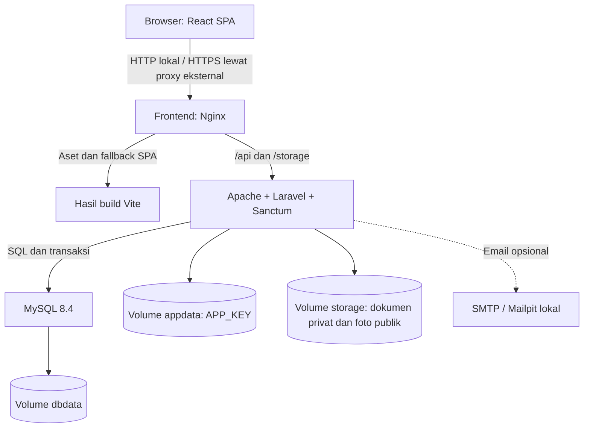

# HealthGuard

Aplikasi pengajuan, peninjauan, dan pencatatan klaim kesehatan. Klien mengirim data serta dokumen
pendukung, analis meninjau klaim yang ditugaskan kepadanya, dan administrator mengelola akun staf,
katalog, serta catatan pembayaran.

Monorepo: **React + TypeScript** SPA, **Laravel REST API + Sanctum**, **MySQL 8.4** melalui Docker
Compose, dan **Terraform** opsional untuk VM Azure.

> **Status — 27 November 2026: audit kebenaran fungsional sedang berjalan.**
> Fitur dinyatakan lengkap menurut backlog 64 tiket yang ditutup 26 November 2026 dengan kriteria QA
> otomatis, dan keputusan produknya tercatat di [ADR](docs/ADR.md). Itu bukan bukti bahwa setiap alur
> pengguna sudah benar. Tracker aktif: [docs/HEALTHGUARD_FUNCTIONALITY_AUDIT.md](docs/HEALTHGUARD_FUNCTIONALITY_AUDIT.md).
> Semua angka tes di repository adalah bukti bertanggal pada revisi yang dicatat, bukan status CI
> commit terakhir. Branch `main` pada saat pembersihan dokumen: `20f7601`.

## Dokumentasi

| Dokumen | Isi | Status |
|---|---|---|
| [README.md](README.md) | Tujuan, arsitektur, cara menjalankan, navigasi | CURRENT |
| [DOCKER.md](DOCKER.md) | Mode operasi, Compose, migrasi SQLite, backup/restore, produksi | CURRENT |
| [docs/API.md](docs/API.md) | Kontrak endpoint, bentuk respons, kode status | CURRENT |
| [docs/ADR.md](docs/ADR.md) | Keputusan arsitektur dan definisi metrik (sumber kanonik keputusan) | CURRENT |
| [docs/RETENTION.md](docs/RETENTION.md) | Retensi, permintaan penghapusan, purge | CURRENT |
| [docs/QA.md](docs/QA.md) | Prosedur verifikasi dan catatan sesi bertanggal | CURRENT |
| [docs/TEST-COVERAGE.md](docs/TEST-COVERAGE.md) | Peta kriteria tiket ke tes otomatis | CURRENT |
| [docs/HEALTHGUARD_FUNCTIONALITY_AUDIT.md](docs/HEALTHGUARD_FUNCTIONALITY_AUDIT.md) | Audit fungsional Stage A: temuan, bukti, status | ACTIVE |
| [Health_Guard-backend/README.md](Health_Guard-backend/README.md) | Setup PHP, lapisan API, ERD, auth, dokumen privat, command | CURRENT |
| [Health_Guard-frontend/README.md](Health_Guard-frontend/README.md) | Setup Node, route, komponen, alur data, tes | CURRENT |
| [IMPROVEMENT.md](IMPROVEMENT.md) | Backlog 64 tiket, ditutup 26 November 2026 | HISTORICAL |
| [docs/archive/implementation-evidence-2026-11.md](docs/archive/implementation-evidence-2026-11.md) | Bukti tes bertanggal untuk backlog tersebut | HISTORICAL |
| [docs/archive/hg-backlog-and-progress-2026-11.md](docs/archive/hg-backlog-and-progress-2026-11.md) | Siklus backlog HG sebelumnya (23 tiket) dan log progres | HISTORICAL |
| [docs/repository-cleanup-report.md](docs/repository-cleanup-report.md) | Laporan pembersihan repository Stage 0 | CURRENT |

Aturan navigasi: satu topik satu dokumen. Aturan produk dan keputusan ada di
[ADR](docs/ADR.md), kontrak HTTP di [API](docs/API.md), operasi container di [DOCKER.md](DOCKER.md),
detail internal masing-masing aplikasi di README backend/frontend. Dokumen `HISTORICAL` dipertahankan
sebagai bukti, bukan sebagai spesifikasi.

## Menjalankan aplikasi

Tiga jalur yang berbeda. Jangan mencampurnya: hasil di satu jalur bukan bukti untuk jalur lain.

### 1. Manual tanpa Docker — mode pengembangan utama

Docker Desktop **tidak** diperlukan dan bukan prasyarat proyek. Jalankan API dan SPA langsung, baik
di workstation maupun di VM:

1. Backend: PHP sesuai manifest (`^8.3`; container/CI memakai 8.4), Composer 2, SQLite atau MySQL.
   Ikuti [pengembangan lokal backend](Health_Guard-backend/README.md#pengembangan-lokal) —
   `composer install`, env, `key:generate`, `migrate`, lalu `php artisan serve --host=127.0.0.1 --port=8000`.
2. Frontend: Node 22 dan npm. Ikuti [pengembangan lokal frontend](Health_Guard-frontend/README.md#pengembangan-lokal)
   — `npm ci`, lalu `npm run dev`.
3. Buka **http://127.0.0.1:5173**. Proxy Vite meneruskan `/api` dan `/storage` ke `http://127.0.0.1:8000`
   (lihat `Health_Guard-frontend/vite.config.ts`).

`.env` di root dipakai Compose; `Health_Guard-backend/.env` dipakai Laravel lokal. Keduanya berbeda.

### 2. Docker Compose

Untuk verifikasi container dan deployment di mesin/VM yang memiliki Docker Engine. Dari root:

```powershell
Copy-Item .env.example .env
# Edit .env: APP_ENV, PUBLIC_URL, DB_PASSWORD, DB_ROOT_PASSWORD.
docker compose up -d --build --wait
docker compose exec backend php artisan healthguard:create-admin admin@example.test --name="Administrator"
```

Buka **http://localhost:8080**. Frontend hanya bind ke loopback; backend dan database tidak membuka
port host. Tidak ada akun demo otomatis. Runbook lengkap, migrasi dari SQLite, backup/restore dan
catatan produksi: [DOCKER.md](DOCKER.md).

### 3. VM Azure (Terraform, opsional)

[main.tf](main.tf) memprovision resource group, VNet/subnet, NSG, public IP, NIC dan VM Ubuntu 24.04.
Bootstrap memasang Docker, clone repository, membangun stack, dan memasang `healthguard-sync.timer`
yang memeriksa `origin/main` setiap 10 menit (log di `/var/log/healthguard-sync.log`). VM memakai
autentikasi password, SSH hanya dibuka jika `ssh_allowed_cidr` diisi, dan bootstrap belum memasang
TLS. State Terraform berisi nilai sensitif dan tidak di-commit. Jalur ini membutuhkan review operator;
baca [DOCKER.md](DOCKER.md#mode-operasi) sebelum menjalankannya.

## Arsitektur

Topologi Docker Compose. Pada mode manual, container Nginx/Apache digantikan proses Vite dan
`artisan serve` di host.



- Compose memublikasikan frontend pada `127.0.0.1:8080`; `/storage/documents/` ditolak dan dokumen
  diunduh lewat API terautentikasi. Foto profil tetap publik.
- Queue `sync`, tanpa Redis, worker terpisah, atau WebSocket. Notifikasi default polling 30 detik,
  SSE dan email opt-in lewat feature flag.
- Detail internal: [ERD dan lapisan backend](Health_Guard-backend/README.md#model-data-dan-erd),
  [komponen frontend](Health_Guard-frontend/README.md#arsitektur-frontend).

## Peran dan alur klaim

Backend menegakkan otorisasi; menyembunyikan menu di frontend bukan kontrol keamanan.

| Peran | Tanggung jawab | Batas utama |
|---|---|---|
| `client` | Profil, draf, pengajuan klaim untuk pasien, unggah bukti, chat, pemantauan hasil | Hanya klaim miliknya; tidak boleh mengajukan ulang klaim `Approved` atau yang sudah dibayar |
| `analyst` | Antrean, assignment, tinjauan bukti, permintaan dokumen, keputusan | Hanya keputusan atas klaim yang ditugaskan kepadanya |
| `admin` | Akun staf, undangan analis, katalog, catatan pembayaran, review penghapusan | Tidak mendapat override keputusan analis |

Registrasi publik hanya membuat `client`. Analis dibuat lewat undangan admin atau command operator;
admin pertama dibuat dari terminal.

Alur utama: klien mengisi formulir empat langkah (identitas pasien, layanan dan nominal, dokumen,
tinjauan) → API membuat klaim `Pending` beserta histori → dokumen diunggah per berkas dan dapat
di-retry pada klaim yang sama → analis mengambil assignment, meninjau, lalu memutuskan atau meminta
informasi → klien melengkapi dan mengajukan ulang bila diminta. Pembuatan klaim dan unggahan adalah
request terpisah, sehingga klaim bisa sudah tersimpan saat unggahan gagal.

Lima string status API dipertahankan apa adanya: `Pending`, `Needs Info`, `Approved`, `Rejected`,
`Partially Approved`. Assignment bukan status. Aturan nominal, keputusan, resubmit, SLA dan makna
pembayaran didefinisikan di [ADR](docs/ADR.md) dan [API](docs/API.md).

## Struktur repository

```text
.
├── README.md                     # landing page dan navigasi (dokumen ini)
├── DOCKER.md                     # mode operasi, Compose, migrasi, backup/restore
├── IMPROVEMENT.md                # backlog 64 tiket (HISTORICAL, ditutup)
├── compose.yaml                  # MySQL, API, frontend, Mailpit opsional
├── .env.example                  # konfigurasi Compose lokal
├── main.tf                       # provisioning VM Azure (opsional)
├── auto-sync.ps1                 # watcher Git opsional, bukan runtime aplikasi
├── .github/workflows/ci.yml      # backend, frontend, E2E, Docker checks
├── docker/                       # smoke, concurrency check, backup/restore PowerShell
├── docs/                         # API, ADR, QA, retensi, tracker audit
│   └── archive/                  # bukti dan backlog historis
├── Health_Guard-backend/         # Laravel API (app, database, routes, tests)
└── Health_Guard-frontend/        # React SPA (src/app, tests, docker)
```

## Batas produk

HealthGuard **tidak** melakukan transfer bank, tidak terintegrasi dengan BPJS atau sistem rumah sakit,
dan tidak otomatis menentukan kelayakan medis atau polis. BPJS adalah data profil/klaim. Provider,
diagnosis dan aturan pertanggungan adalah katalog yang dikelola organisasi; analis tetap membuat
keputusan. Mencatat status pembayaran `paid`/`settled` tidak memindahkan uang.

Belum diverifikasi atau belum ada buktinya di repository: audit suara NVDA/VoiceOver, operasi native
OS file picker, zoom browser 200% aktual, SMTP sungguhan, uji beban pada volume data produksi, dan
cutover data live. Bukti MySQL/Compose terakhir juga mendahului commit dokumentasi terakhir. Detail
residual ada di bagian 11 [IMPROVEMENT.md](IMPROVEMENT.md) dan akan ditindaklanjuti lewat tracker
audit.

## Pengujian ringkas

```sh
# backend
composer install && composer test && php vendor/bin/pint --test

# frontend
npm ci && npm run typecheck && npm run lint && npm test && npm run build
npm run test:e2e
```

[Workflow CI](.github/workflows/ci.yml) menjalankan job `backend`, `frontend`, `e2e` dan `docker`;
tidak melakukan deploy. E2E memakai PHP/Vite pada port 8011/4173 dengan SQLite dan storage sementara,
bukan database deployment. Perintah dan batas per suite ada di README backend/frontend serta
[QA](docs/QA.md); bukti bertanggal terakhir ada di
[docs/archive/implementation-evidence-2026-11.md](docs/archive/implementation-evidence-2026-11.md).

## Kontribusi

1. Definisikan capability di policy/role dan validasi input; jangan mengandalkan UI.
2. Perubahan skema melalui migration, bukan edit database manual.
3. Pertahankan lima string status dan bentuk respons yang dipakai frontend.
4. Tambahkan tes positif, negatif dan ownership; jalankan Pint serta suite relevan.
5. Perbarui [API](docs/API.md)/[ADR](docs/ADR.md)/README bila perilaku berubah.

Jangan commit `.env`, backup, token, trace browser, data pasien, atau state Terraform. Lihat
[.gitignore](.gitignore) dan catatan keamanan di [DOCKER.md](DOCKER.md#produksi).
