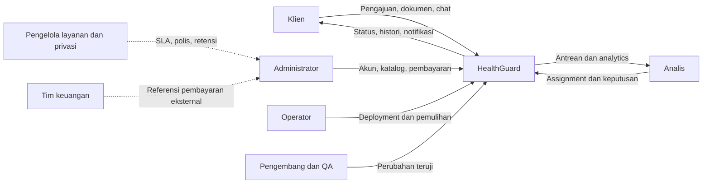
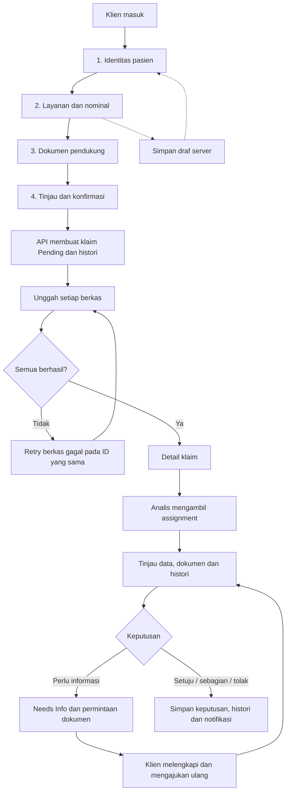
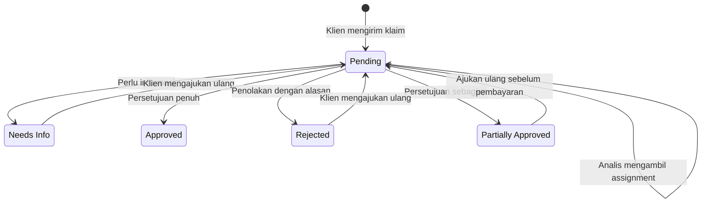
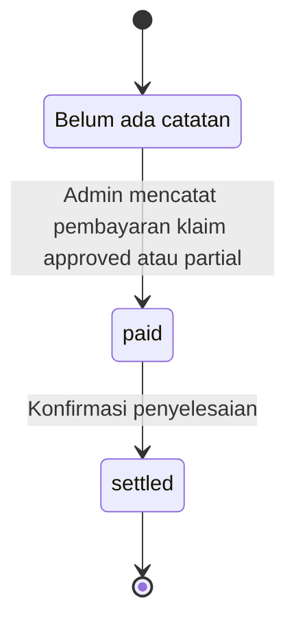
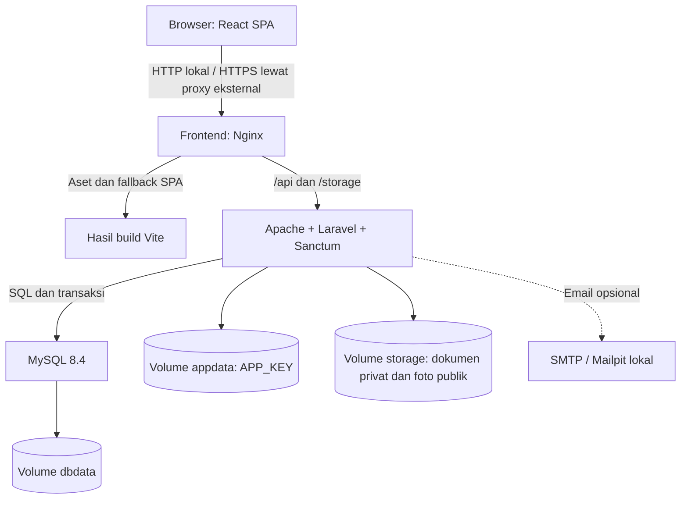
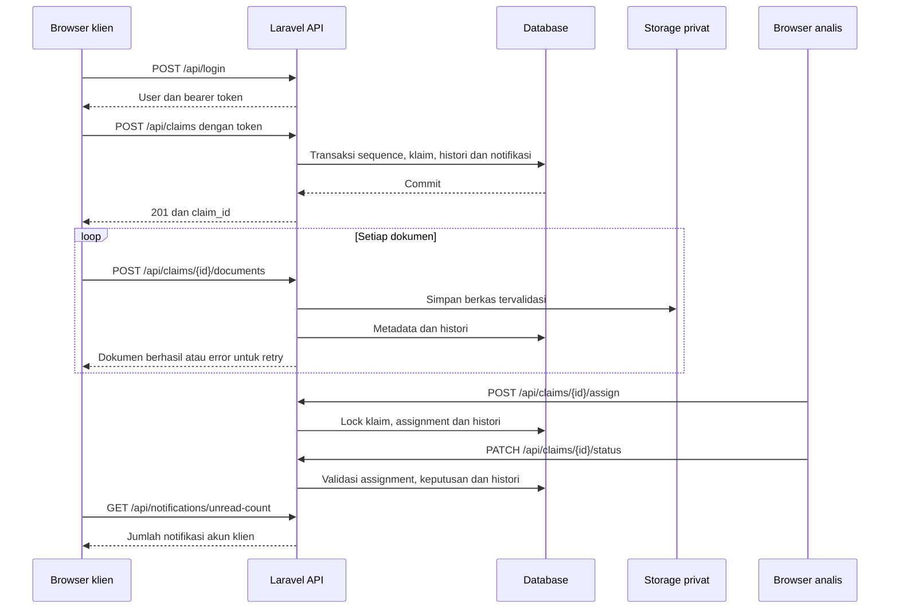
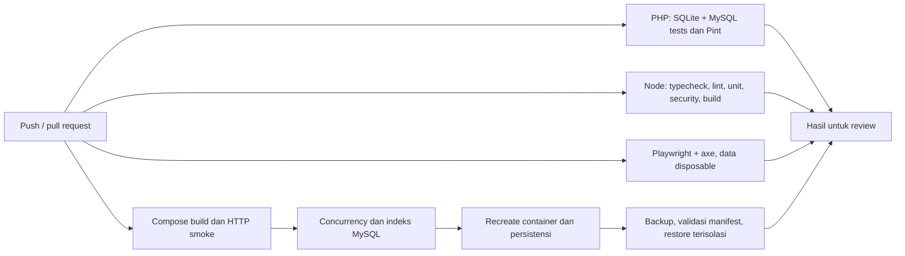

# HealthGuard

HealthGuard adalah aplikasi pengajuan, peninjauan, dan pencatatan klaim kesehatan. Klien mengirim data serta dokumen pendukung, analis meninjau klaim yang ditugaskan kepadanya, dan administrator mengelola akun staf, katalog, serta catatan pembayaran.

Repository ini memuat **React + TypeScript**, **Laravel API + Sanctum**, dan **Docker Compose + MySQL 8.4**. Dokumentasi ditinjau terhadap kode pada **23 November 2026**. Diagram memakai Mermaid agar tersimpan bersama kode dan dapat dibaca melalui GitHub atau renderer Markdown yang mendukungnya.

## Daftar isi

- [Tujuan dan batas produk](#tujuan-dan-batas-produk)
- [Stakeholder](#stakeholder)
- [Hak akses](#hak-akses)
- [Workflow bisnis](#workflow-bisnis)
- [Arsitektur](#arsitektur)
- [Teknologi dan tools](#teknologi-dan-tools)
- [Struktur repository](#struktur-repository)
- [Menjalankan aplikasi](#menjalankan-aplikasi)
- [Konfigurasi](#konfigurasi)
- [Keamanan dan integritas data](#keamanan-dan-integritas-data)
- [Pengujian dan CI](#pengujian-dan-ci)
- [Operasional dan deployment](#operasional-dan-deployment)
- [Troubleshooting](#troubleshooting)
- [Peta dokumentasi dan diagram](#peta-dokumentasi-dan-diagram)

## Tujuan dan batas produk

| Kebutuhan | Implementasi |
|---|---|
| Klaim dapat dilacak | ID `CLM-YYYY-NNN`, detail melalui URL, status, dokumen dan histori |
| Data pasien/layanan | Nama pasien, DOB, ID klien turunan akun, rumah sakit, penyakit, jenis/tanggal layanan, nominal dan keterangan |
| Pengajuan bertahap | Empat langkah formulir, draf server, validasi per field, retry/cancel unggahan |
| Tinjauan operasional | Antrean, assignment atomik, keputusan, permintaan dokumen dan chat |
| Pelaporan | Filter/pagination server, statistik seluruh hasil filter, analytics, CSV/XLSX untuk staf |
| Administrasi | Undangan analis, aktivasi akun, beban kerja/SLA, katalog, pembayaran dan review penghapusan |
| Pengalaman pengguna | Indonesia/English, IDR, waktu Asia/Jakarta, tampilan responsif dan keyboard |

HealthGuard **tidak melakukan transfer bank**, tidak terintegrasi dengan BPJS/sistem rumah sakit, dan tidak otomatis menentukan kelayakan medis atau polis. BPJS merupakan data profil/klaim. Provider, diagnosis dan aturan pertanggungan merupakan katalog yang dikelola organisasi; analis tetap membuat keputusan. Foto profil bersifat publik melalui storage; dokumen klaim bersifat privat.

## Stakeholder

Tiga role aplikasi adalah `client`, `analyst`, dan `admin`. Stakeholder lain di bawah merupakan tanggung jawab organisasi, bukan role tambahan di UI.

| Stakeholder | Tanggung jawab | Interaksi |
|---|---|---|
| Klien / pemegang akun | Mengelola profil, mengajukan klaim untuk pasien, melengkapi bukti, memantau hasil | Formulir, draf, detail, chat, notifikasi, profil |
| Analis klaim | Mengambil klaim, meninjau bukti, meminta informasi, menetapkan keputusan | Antrean, detail, dokumen, histori, analytics |
| Administrator | Mengelola pengguna/katalog, mengundang analis, mencatat pembayaran, review penghapusan | Administrasi dan detail klaim |
| Tim keuangan | Merekonsiliasi pembayaran di luar aplikasi | Pencatatan melalui admin; belum ada role keuangan terpisah |
| Pemilik produk / pengelola layanan | Menetapkan SLA, kategori, aturan pertanggungan dan kriteria penerimaan | Konfigurasi, katalog, laporan dan QA |
| Pengelola privasi / auditor | Menetapkan retensi serta meninjau akses dan jejak perubahan | Kebijakan organisasi dan histori; belum ada role auditor khusus |
| Pengembang dan QA | Merawat API/UI, migrasi, dokumentasi dan tes | Source code dan CI |
| Operator / DevOps | Deployment, TLS, database, storage, backup dan pemulihan | Docker, Artisan, PowerShell dan infrastruktur |



## Hak akses

Backend menegakkan otorisasi; penyembunyian menu frontend bukan kontrol keamanan utama.

| Tindakan | Klien | Analis | Admin |
|---|---|---|---|
| Baca klaim/dokumen/histori | Milik sendiri | Semua klaim | Semua klaim |
| Buat klaim dan draf | Ya | Tidak | Tidak |
| Ajukan ulang | Milik sendiri, status sesuai, belum dibayar | Tidak | Tidak |
| Ambil assignment | Tidak | `Pending` yang belum ditugaskan | Tidak |
| Keputusan / minta dokumen | Tidak | Hanya assigned kepadanya | Tidak |
| Kirim chat | Klaim sendiri | Hanya assigned kepadanya | Tidak |
| Unggah dokumen | Klaim sendiri | Lampiran pesan miliknya pada klaim assigned | Tidak |
| Analytics / CSV / XLSX | Tidak | Ya | Ya |
| Kelola akun staf/katalog | Tidak | Tidak | Ya |
| Catat pembayaran | Tidak | Tidak | Ya |
| Review penghapusan | Tidak | Tidak | Ya, dengan guard retensi |
| 2FA TOTP | Tidak | Opsional | Opsional |

Registrasi publik hanya membuat klien. Analis dibuat melalui undangan admin atau command operator. Admin awal dibuat melalui terminal; tidak ada registrasi admin publik. Admin tidak mendapat override keputusan analis.

## Workflow bisnis

### Onboarding akun

1. Operator menjalankan stack dan membuat administrator pertama.
2. Admin mengundang analis. Tautan undangan berlaku 24 jam dan sekali pakai.
3. Klien mendaftar sendiri dan melengkapi profil.
4. Staf dapat mengaktifkan TOTP dan menyimpan recovery code sekali pakai.
5. Verifikasi email/lupa password membutuhkan mailer yang dikonfigurasi. Login biasa tidak mewajibkan email terverifikasi.

### Pengajuan hingga keputusan



Pembuatan klaim dan pengiriman dokumen adalah request terpisah. Klaim dapat sudah tersimpan saat upload gagal. Retry mempertahankan ID dan melewati berkas yang sudah dikonfirmasi berhasil. Setelah reload, buka detail klaim untuk melanjutkan unggahan. Draf hanya menyimpan data formulir; berkas perlu dipilih ulang.

### Status klaim



Diagram menampilkan **alur operasional umum**, bukan seluruh transisi API. Assigned analyst dapat memperbarui keputusan ke salah satu dari lima status selama belum ada pembayaran. Assignment bukan status keenam; klaim yang baru diambil analis tetap `Pending`. Klien tidak dapat mengajukan ulang `Approved`.

| Aturan | Perilaku |
|---|---|
| Nominal | Lebih dari nol, maksimal 99.999.999,99 IDR; paling banyak dua digit desimal |
| Approved | Approved amount sama dengan nominal klaim |
| Partially Approved | Approved amount wajib, positif, tidak melebihi nominal klaim |
| Rejected / Needs Info | Catatan keputusan wajib |
| Resubmit | Hanya pemilik, dari Rejected/Needs Info/Partially Approved, tanpa pembayaran |
| Hasil resubmit | Pending; approved amount kosong; assignment/catatan tetap; snapshot lama masuk histori |
| Sesudah paid | Perubahan keputusan dan resubmit ditolak |
| SLA | Waktu pengajuan awal + `CLAIM_SLA_HOURS`, default 72 jam; tidak reset saat resubmit |

### Pembayaran



Satu klaim memiliki paling banyak satu catatan pembayaran. Nominal tidak boleh melebihi persetujuan. Transisi ke `settled` mempertahankan nominal dan referensi. Status klaim tidak berubah menjadi status pembayaran. Transaksi bank dilakukan di luar aplikasi.

### Retensi dan penghapusan

Pengguna mengirim permintaan, lalu admin meninjau dengan catatan dan konfirmasi. Approval membutuhkan fitur retensi aktif dan tidak adanya klaim terbuka (`Pending`/`Needs Info`). Penghapusan admin membutuhkan operator. Catatan review dipertahankan dengan relasi user nullable. Purge berdasarkan umur `updated_at` klaim tersedia sebagai command terpisah, belum dijadwalkan otomatis. Lihat [retensi](docs/RETENTION.md) dan [diagram backend](Health_Guard-backend/README.md#retensi-dan-penghapusan).

## Arsitektur



Compose hanya memublikasikan frontend pada `127.0.0.1:8080` secara default. Backend dan database tidak membuka port host. `/storage/documents/` ditolak; dokumen diunduh lewat API terautentikasi. TLS/domain/reverse proxy publik dikelola di luar stack standar.



Lihat [ERD backend](Health_Guard-backend/README.md#model-data-dan-erd) dan [komponen frontend](Health_Guard-frontend/README.md#arsitektur-frontend) untuk struktur internal.

## Teknologi dan tools

Versi berasal dari manifest, Dockerfile dan CI repository, bukan klaim versi terbaru. Lockfile menentukan versi instalasi tepat.

| Lapisan | Teknologi | Penggunaan |
|---|---|---|
| UI | React 18.3.1, TypeScript 5.8, React Router 7.13 | SPA, routing, tipe data |
| HTTP/feedback | Axios, Sonner | API bearer, sesi, toast |
| Build/style | Vite 6.3.5, plugin React, CSS lokal | Aset dan tampilan portal |
| Ekspor | SheetJS `xlsx` | Konversi CSV server menjadi XLSX di browser |
| API | PHP `^8.3`, Laravel `^13.8`, Sanctum `^4.3` | Validasi, policy, transaksi, token |
| Container | PHP 8.4 + Apache, Node 22 saat build, Nginx | Runtime API dan penyajian SPA |
| Database | MySQL 8.4; SQLite lokal/tes/import | Data relasional |
| Tool PHP | Composer 2, Artisan, PHPUnit 12, Pint | Dependensi, command, tes, format |
| Tool UI | npm, ESLint 9, Prettier 3, Vitest 3, Testing Library | Install, lint, format, tes komponen |
| Browser QA | Playwright, axe-core | Workflow, keyboard, responsivitas, aksesibilitas otomatis |
| Operasional | Docker Compose, PowerShell, GitHub Actions | Orkestrasi, backup/restore, CI |
| Email lokal | Mailpit 1.27, profil `mail-dev` | Menangkap email uji |
| Infrastruktur opsional | Terraform ≥1.5, AzureRM, random | Provisioning VM Azure |
| Version control | Git, `auto-sync.ps1` opsional | Riwayat kode; watcher dapat commit/push otomatis |

Package JavaScript backend adalah scaffold Laravel; **UI utama ada di frontend**. Compose tidak memiliki Redis, worker queue terpisah atau WebSocket. Queue memakai `sync`; notifikasi default polling 30 detik, SSE opt-in.

## Struktur repository

```text
.
├── README.md                     # Produk, stakeholder, workflow dan onboarding
├── IMPROVEMENT.md                # Backlog dan acceptance criteria
├── DOCKER.md                     # Runbook deployment, migrasi, backup, restore
├── compose.yaml                 # MySQL, API, frontend, Mailpit opsional
├── .env.example                 # Konfigurasi Compose lokal
├── main.tf                      # Provisioning Azure opsional
├── auto-sync.ps1                 # Watcher Git, bukan runtime aplikasi
├── .github/workflows/ci.yml      # Backend, frontend, E2E, Docker checks
├── docker/                      # Backup, restore, smoke, concurrency checks
├── docs/                        # API, ADR, QA, retensi, bukti implementasi
├── Health_Guard-backend/
│   ├── app/                     # Controller, request, policy, service, model, resource
│   ├── database/                # Migration, factory, seeder
│   ├── routes/                  # API, web/health, console
│   ├── tests/                   # PHPUnit
│   └── docker/                  # Apache, entrypoint, upload limits
└── Health_Guard-frontend/
    ├── src/app/portal/          # UI bisnis
    ├── src/app/api/             # Axios/interceptor
    ├── src/app/state/           # Authentication
    ├── src/styles/             # CSS
    ├── tests/                  # Komponen, security, E2E
    └── docker/                 # Nginx
```

## Menjalankan aplikasi

### Docker Compose

Prasyarat: Git, Docker Engine/Desktop dengan Linux containers dan Compose yang mendukung `--wait`. Node/PHP lokal tidak diperlukan untuk menjalankan image.

Dari root repository, untuk instalasi baru:

```powershell
Copy-Item .env.example .env
# Edit .env: sesuaikan password database dan lingkungan.
docker compose up -d --build --wait
docker compose ps
docker compose exec backend php artisan healthguard:create-admin admin@example.test --name="Administrator"
```

Di Bash gunakan `cp .env.example .env`. Jangan menimpa konfigurasi yang sudah digunakan. Command admin meminta password secara tersembunyi. Buka **http://localhost:8080**, login admin, undang analis; klien mendaftar sendiri. Tidak ada akun demo otomatis.

Contoh root memakai `APP_ENV=local`; produksi membutuhkan `production`, password unik/kuat dan [konfigurasi produksi](DOCKER.md#produksi). Default Compose tanpa override adalah `production`.

### Pengembangan tanpa Docker

Gunakan Node 22/npm, PHP sesuai manifest beserta ekstensi, Composer 2, SQLite/MySQL. Buka dua terminal:

1. Ikuti [setup backend](Health_Guard-backend/README.md#pengembangan-lokal): dependensi, env, database, key, migrasi, server port 8000.
2. Ikuti [setup frontend](Health_Guard-frontend/README.md#pengembangan-lokal): `npm ci`, Vite port 5173.
3. Buka **http://127.0.0.1:5173**. Proxy Vite meneruskan `/api` dan `/storage`.

`.env` root dipakai Compose; `Health_Guard-backend/.env` dipakai Laravel lokal. Keduanya berbeda.

## Konfigurasi

| Variabel | Default Compose | Fungsi |
|---|---|---|
| `HEALTHGUARD_PORT` | `8080` | Port frontend loopback |
| `PUBLIC_URL` | `http://localhost:8080` | Menjadi APP_URL dan FRONTEND_URL backend |
| `DB_DATABASE`, `DB_USERNAME` | `healthguard` | Database/akun aplikasi |
| `DB_PASSWORD`, `DB_ROOT_PASSWORD` | Wajib | Kredensial MySQL |
| `APP_KEY` | Kosong pada instalasi baru | Entrypoint membuat dan mempertahankan key di appdata |
| `SANCTUM_TOKEN_EXPIRATION` | `480` | Masa token, menit |
| `CLAIM_SLA_HOURS` | `72` | SLA sejak pengajuan awal |
| `FEATURE_MESSAGES`, `FEATURE_PAYMENTS` | `true` | Chat dan catatan pembayaran |
| `FEATURE_EMAIL`, `FEATURE_REALTIME` | `false` | Email dan SSE opsional |
| `FEATURE_RETENTION`, `RETENTION_DAYS` | `false`, `0` | Guard penghapusan dan umur purge |
| `DEMO_SEED_ENABLED` | `false` | Izin demo seeder hanya local/testing |
| `TRUSTED_PROXIES`, `TRUSTED_HOSTS` | Kosong | Proxy/hostname tepercaya |

Email lokal: set `FEATURE_EMAIL=true`, `MAIL_MAILER=smtp`, `MAIL_HOST=mailpit`, `MAIL_PORT=1025`, lalu `docker compose --profile mail-dev up -d --build --wait`. UI Mailpit: **http://localhost:8025**. Email notifikasi klaim dikirim setelah commit kepada pengguna aktif dengan email terverifikasi, tanpa rincian medis.

## Keamanan dan integritas data

- Sanctum bearer token disimpan frontend di `localStorage`. Quick sign-in hanya menyimpan nama/email/role dan tetap meminta password.
- Password berubah, logout semua perangkat, atau deaktivasi akun mencabut token terkait. TOTP staf mencegah replay; recovery code sekali pakai.
- Backend memeriksa role, ownership dan assignment; klien tidak dapat membaca klaim klien lain.
- Dokumen PDF/JPG/PNG/DOC/DOCX divalidasi ekstensi, MIME/konten dan ukuran 1 byte–10 MB; foto JPG/PNG maksimal 2 MB.
- ID klaim, assignment dan keputusan memakai transaksi/locking. Histori tidak memiliki API edit/delete; penghapusan melalui retensi berizin tetap dapat menghapus relasi.
- Backup harus mencakup database, storage dan APP_KEY yang cocok untuk data 2FA terenkripsi.
- Log API menyimpan request ID, route, status dan durasi. Jangan menambahkan token/body/dokumen/data pasien ke log atau commit.

## Pengujian dan CI



[Workflow CI](.github/workflows/ci.yml) tidak otomatis deploy produksi. Perintah lokal tersedia pada README backend/frontend. E2E menggunakan PHP/Vite port 8011/4173 dengan SQLite/storage sementara, bukan database deployment.

Bukti **22 November 2026**: backend 167 tes lulus, 2 skip khusus database, 859 asersi; Pint lulus; frontend 33 tes dan 5 tes cookie-security lulus; typecheck/lint/build lulus; 9 tes browser lulus dan 2 tes terarah lulus setelah perbaikan validasi. Ini bukti bertanggal pada revisi yang dicatat, bukan status CI langsung commit berikutnya.

[Backlog](IMPROVEMENT.md) tercatat 64/64 selesai menurut kriteria QA otomatis yang disetujui pengguna. Audit suara NVDA/VoiceOver, native picker, zoom browser aktual, konfigurasi produksi dan uji beban tidak dibuktikan oleh hasil tersebut. Rincian: [implementasi](docs/IMPLEMENTATION.md), [QA](docs/QA.md), [cakupan tes](docs/TEST-COVERAGE.md).

## Operasional dan deployment

| Area | Tindakan / rujukan |
|---|---|
| Status/log | `docker compose ps`; `docker compose logs --tail=100 backend` |
| Liveness | Frontend `/healthz`; backend internal `/up` |
| Readiness | Backend internal `/health/ready` memeriksa DB; bukan route SPA frontend |
| Backup/restore | [DOCKER.md](DOCKER.md), script PowerShell `docker/` |
| SQLite lama | Import ke MySQL kosong, pertahankan key, rekonsiliasi file/record |
| Retensi | [RETENTION.md](docs/RETENTION.md); dry run/review sebelum apply; belum ada scheduler otomatis |
| Upgrade | Backup, uji stack terisolasi, cutover; pertahankan volume |
| Observabilitas | Rotasi log container; pengumpulan log/alerting organisasi dikonfigurasi terpisah |

### Azure opsional

[main.tf](main.tf) mendefinisikan resource group, VNet/subnet, NSG, public IP, NIC dan VM Ubuntu 24.04. Bootstrap memasang Docker, clone repository, build stack, mengubah frontend menjadi publik pada port 80, lalu mencoba membuat admin. Ini berbeda dari Compose standar yang bind loopback.

VM memakai autentikasi password; SSH dibuka jika `ssh_allowed_cidr` diisi. Bootstrap belum memasang TLS; state Terraform berisi nilai sensitif. Jalur ini membutuhkan review operator. VM memeriksa `origin/main` setiap 10 menit melalui `healthguard-sync.timer`: hanya kontainer yang sumbernya berubah yang dibangun ulang, database dan volume tidak disentuh, dan SHA yang berhasil dipasang disimpan agar build gagal dicoba lagi. Log ada di `/var/log/healthguard-sync.log`. README ini tidak menjalankan provisioning atau menyatakan kondisi deployment Azure saat ini.

### Auto-sync Git opsional

[auto-sync.ps1](auto-sync.ps1) melakukan add/commit/push ketika dijalankan. Script bukan service aplikasi atau bagian CI. Periksa branch dan ignore rules sebelum memakainya; env, backup, trace browser dan build tidak perlu dipublikasikan. Kontributor dapat memakai workflow Git biasa tanpa watcher.

## Troubleshooting

| Gejala | Pemeriksaan |
|---|---|
| Compose gagal membaca password | Cek env root dan variabel DB; produksi menolak nilai contoh |
| Backend tidak ready | Health MySQL, log backend, DB dan akses volume |
| Login ulang setelah ubah password | Normal: token dicabut |
| Keputusan mendapat 403 | Role analis dan assignment harus sesuai |
| Resubmit/assignment mendapat 409 | Status tidak sesuai, assignment sudah diambil, atau klaim sudah dibayar |
| Upload gagal | MIME/ekstensi/ukuran; retry pada klaim yang sama |
| Foto lokal tidak tampil | Jalankan `php artisan storage:link` pada backend lokal |
| Email tidak terkirim | Feature flag, mailer dan SMTP; `array` tidak mengirim keluar |
| PowerShell memblokir npm.ps1 | Gunakan `npm.cmd`, tanpa mengubah execution policy |
| E2E tidak mulai | PHP/browser/dependensi tersedia; port 4173/8011 kosong |
| Deep link 404 | Server frontend perlu SPA fallback seperti Nginx repository |

## Peta dokumentasi dan diagram

| Dokumen | Isi / diagram |
|---|---|
| [README root](README.md) | Stakeholder, workflow, state klaim/pembayaran, deployment, sequence pengajuan, CI |
| [Backend](Health_Guard-backend/README.md) | Setup PHP, lapisan API, ERD, auth, dokumen privat, retensi, command |
| [Frontend](Health_Guard-frontend/README.md) | Setup Node, route, komponen, aliran data, form/retry dan tes |
| [API](docs/API.md) | Kontrak endpoint; routes/requests/resources menjadi rujukan implementasi |
| [ADR](docs/ADR.md) | Keputusan arsitektur dan definisi metrik |
| [Docker](DOCKER.md) | Instalasi, migrasi, backup, restore, produksi |
| [QA](docs/QA.md) / [cakupan](docs/TEST-COVERAGE.md) | Skenario dan batas verifikasi |
| [Implementasi](docs/IMPLEMENTATION.md) | Hasil bertanggal dan revisi kode |
| [Retensi](docs/RETENTION.md) | Kebijakan penghapusan |
| [Improvement](IMPROVEMENT.md) | Backlog dan kriteria penerimaan |

Untuk kontribusi: pahami role/policy, gunakan migrasi untuk perubahan skema, perbarui tes/dokumentasi terdampak, jalankan pemeriksaan relevan. Pertahankan lima string status API dan jangan memakai fixture demo pada produksi.
